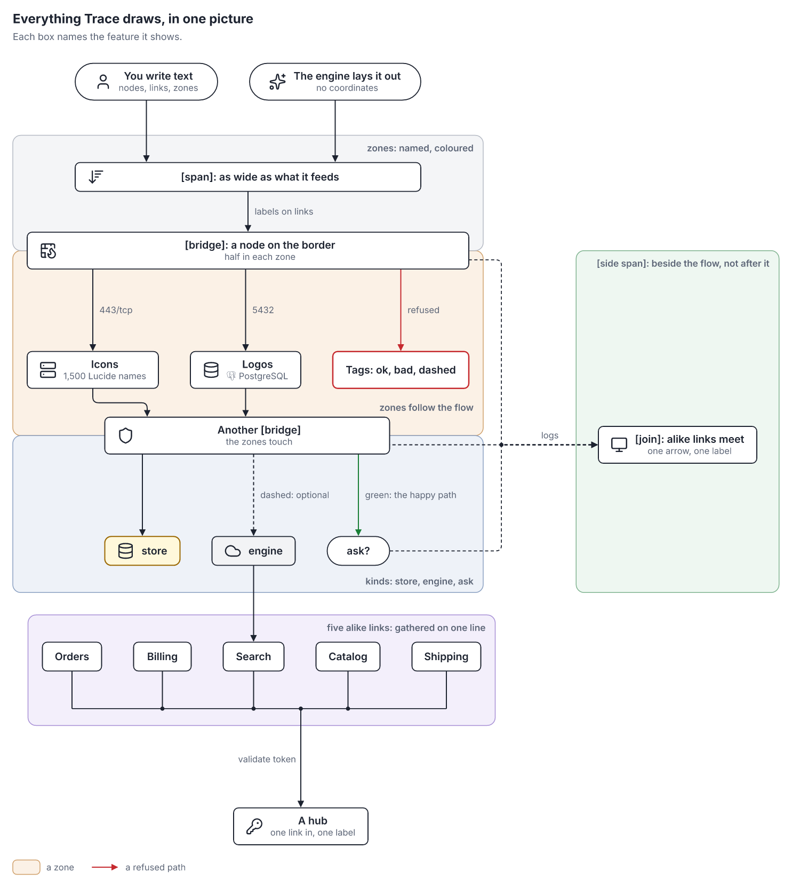
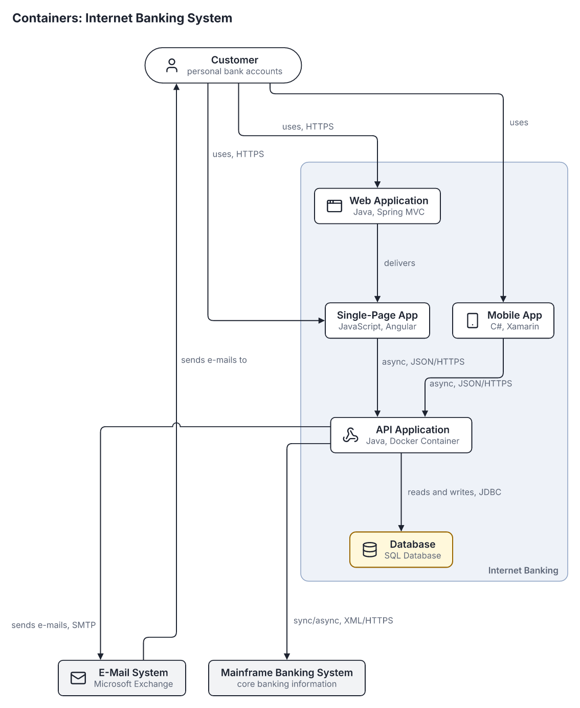
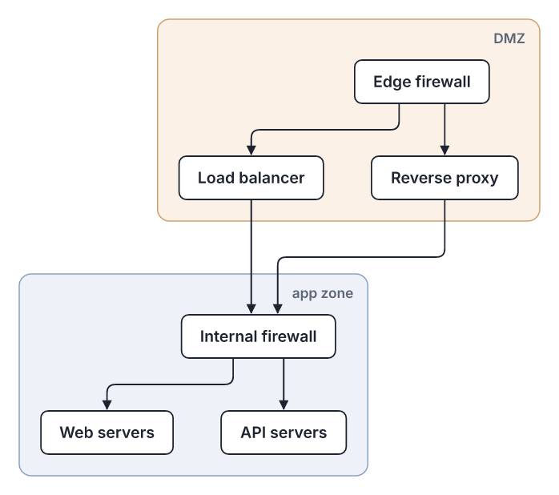
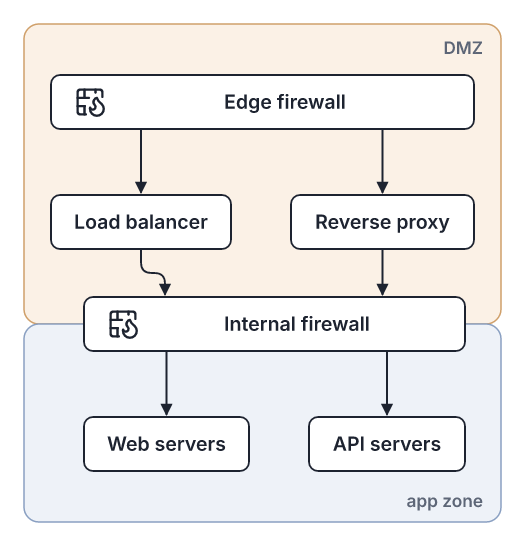
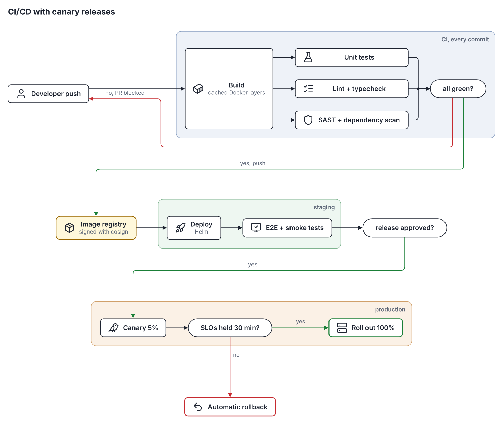
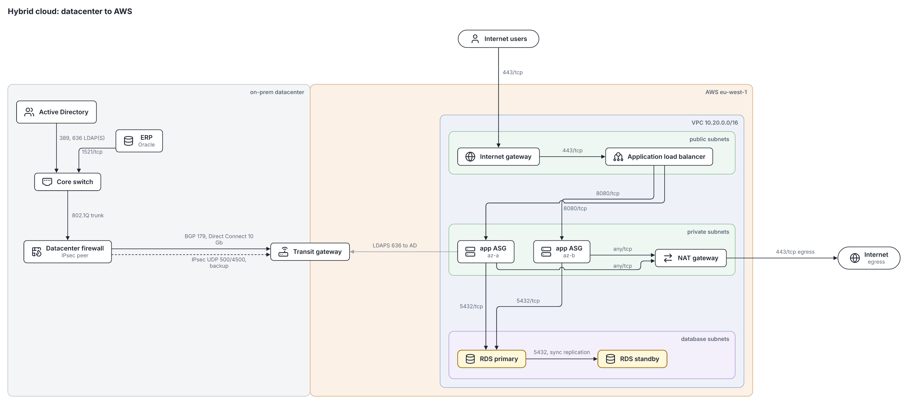
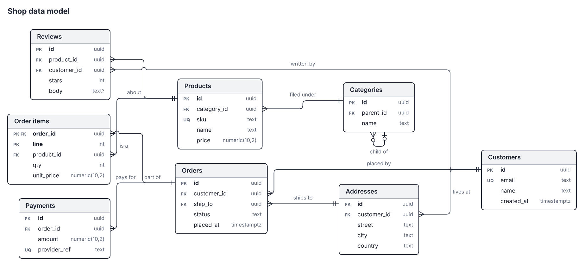
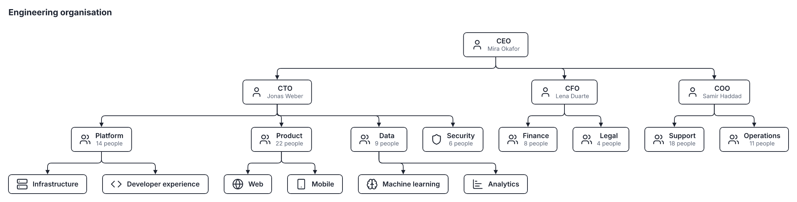

# Trace

Draw architecture and network diagrams from plain text.

Trace is a diagram-as-code tool inspired by Mermaid: you write nodes, links and zones in a text file, and it lays
them out for you.

Mermaid draws what you write, but you can't tell it where things go, so a large diagram often comes out tangled.
Trace lets you add a hint where it matters (this firewall sits on that border, these services go side by side), so
the diagram comes out the way you would have drawn it yourself.

<picture>
  <source media="(prefers-color-scheme: dark)" srcset="docs/images/everything.dark.png">
  
</picture>

<!-- source examples/playground/everything.trace "The Trace source of this drawing" -->
<details><summary>The Trace source of this drawing</summary>

```
direction down
title "Everything Trace draws, in one picture"
caption "Each box names the feature it shows."

column {
  row {
    pill you [user]: You write text | nodes, links, zones
    pill auto [sparkles]: The engine lays it out | no coordinates
  }
  frame edge "zones: named, coloured" [grey] {
    span [span arrow-down-wide-narrow]: [span]: as wide as what it feeds
  }
}
frame dmz "zones follow the flow" [orange] {
  bridge [bridge span firewall]: [bridge]: a node on the border | half in each zone
  row {
    icons [server]: Icons | 1,500 Lucide names
    logos [database postgresql]: Logos
    kinds [bad]: Tags: ok, bad, dashed
  }
}
frame app "kinds: store, engine, ask" [blue] {
  bridge2 [bridge span shield]: Another [bridge] | the zones touch
  row {
    store one [database]: store
    engine two [cloud]: engine
    ask three: ask?
  }
}
frame watch "[side span]: beside the flow, not after it" [green side span] {
  gate [join monitor]: [join]: alike links meet | one arrow, one label
}

you -> span
auto -> span
span -> bridge : labels on links
bridge -> icons : 443/tcp
bridge -> logos : 5432
bridge -> kinds [bad] : refused
icons -> bridge2
logos -> bridge2
bridge2 -> one
bridge2 -> two [dashed] : dashed: optional
bridge2 -> three [ok] : green: the happy path
bridge --> gate : logs
bridge2 --> gate : logs
three --> gate : logs

key frame [orange] : a zone
key -> [bad] : a refused path

frame hub "five alike links: gathered on one line" [purple] {
  row {
    s1: Orders
    s2: Billing
    s3: Search
    s4: Catalog
    s5: Shipping
  }
}
idp [key]: A hub | one link in, one label
s1 -> idp : validate token
s2 -> idp : validate token
s3 -> idp : validate token
s4 -> idp : validate token
s5 -> idp : validate token
two -> s3
```

</details>
<!-- /source -->

## Why Trace

- **Without hints, at least as good as Mermaid.** Write nodes and links only, and the automatic layout must read
  at least as well as Mermaid's drawing of the same diagram. This is measured on 27 real diagrams (below).
- **With hints, the diagram you had in mind.** Rows and columns, `[span]`, `[bridge]`, side zones, `align`, `mark`,
  `[join]`, `tree`, icons and logos: each is optional, and each says something the layout cannot guess.

## Text in, diagram out

<table>
<tr>
<td valign="top">

<!-- source examples/cases/payment.trace open -->

```
title "Payment lifecycle"
direction down

start s
state created: created
state authorized: authorized
state captured: captured
state partial: partially refunded
state disputed [bad]: disputed
final failed [bad]: failed
final voided: voided
final refunded: refunded
final lost [bad]: chargeback

s -> created : PaymentIntent created
created -> authorized : card authorized
created -> failed [bad] : declined or 3DS failed
authorized -> captured [ok] : captured
authorized -> voided : voided or auth expired
captured -> partial : partial refund
partial -> partial : another partial refund
partial -> refunded : rest refunded
captured -> refunded : full refund
captured -> disputed [bad] : customer disputes
captured <- disputed [ok] : dispute won
disputed -> lost [bad] : dispute lost

key final : terminal state
key -> [bad] : money at risk
```

<!-- /source -->

</td>
<td valign="top">
<picture>
  <source media="(prefers-color-scheme: dark)" srcset="docs/images/payment.dark.png">
  
</picture>
</td>
</tr>
</table>

Nodes are a name and a label (`a: Label | a note under it`), links are arrows with an optional label, and
everything else is optional: a kind (`state`, `store`, `pill`, `final`…), a tag (`[bad]`, `[dashed]`, an icon
such as `[database]` or a technology logo such as `[postgresql]`), a frame around a zone. Orthogonal links,
rounded corners, arrowheads that stop short of the box, hops where two links cross, labels with a halo, light
and dark: the style is built in. The full language is in the [manual](docs/manual.md).

## The same diagram three ways

The C4 container diagram of the “Internet Banking System”, one of the real diagrams Trace is measured on.
First as Mermaid draws it (GitHub draws this one live from the text):


<table>
<tr>
<th width="50%">Trace, the same nodes and links, no layout help</th>
<th width="50%">Trace, with hints</th>
</tr>
<tr>
<td valign="top">
<picture>
  <source media="(prefers-color-scheme: dark)" srcset="docs/images/bigbank-plain.dark.png">
  
</picture>
</td>
<td valign="top">
<picture>
  <source media="(prefers-color-scheme: dark)" srcset="docs/images/bigbank-full.dark.png">
  
</picture>
</td>
</tr>
<tr>
<td valign="top">Nodes, links, one frame, a few icons.

<!-- source examples/holdout/bigbank-container.trace -->
<details><summary>Trace source</summary>

```
# Adapted from C4-PlantUML, samples/C4_Container Diagram Sample - bigbankplc.puml (MIT)
direction down
title "Containers: Internet Banking System"

pill customer [user]: Customer | personal bank accounts

frame c1 "Internet Banking" [blue] {
  web [browser]: Web Application | Java, Spring MVC
  spa: Single-Page App | JavaScript, Angular
  mobile [mobile]: Mobile App | C#, Xamarin
  store database [database]: Database | SQL Database
  api [api]: API Application | Java, Docker Container
}

engine email [mail]: E-Mail System | Microsoft Exchange
engine banking: Mainframe Banking System | core banking information

customer -> web : uses, HTTPS
customer -> spa : uses, HTTPS
customer -> mobile : uses
web -> spa : delivers
spa -> api : async, JSON/HTTPS
mobile -> api : async, JSON/HTTPS
api -> database : reads and writes, JDBC
email -> customer : sends e-mails to
api -> email : sends e-mails, SMTP
api -> banking : sync/async, XML/HTTPS
```

</details>
<!-- /source -->

</td>
<td valign="top">The same, plus two icons, a <code>row</code> for the
three front ends, a <code>row</code> for the API and its database, and two links written with <code>&lt;-</code>
so the e-mail system stands beside the customer instead of under everything.

<!-- source examples/holdout/full/bigbank-container.trace -->
<details><summary>Trace source</summary>

```
# Full-feature version of ../bigbank-container.trace: the same nodes, links and labels, written with Trace's layout features. Not part of the held-out measure.
direction down
title "Containers: Internet Banking System"

row {
  pill customer [user]: Customer | personal bank accounts
  engine email [mail]: E-Mail System | Microsoft Exchange
}
frame c1 "Internet Banking" [blue] {
  row {
    web [browser]: Web Application | Java, Spring MVC
    spa [app-window javascript]: Single-Page App | JavaScript, Angular
    mobile [mobile]: Mobile App | C#, Xamarin
  }
  row {
    api [api]: API Application | Java, Docker Container
    store database [database]: Database | SQL Database
  }
}
engine banking [server]: Mainframe Banking System | core banking information

customer -> web : uses, HTTPS
customer -> spa : uses, HTTPS
customer -> mobile : uses
web -> spa : delivers
spa -> api : async, JSON/HTTPS
mobile -> api : async, JSON/HTTPS
api -> database : reads and writes, JDBC
customer <- email : sends e-mails to
email <- api : sends e-mails, SMTP
api -> banking : sync/async, XML/HTTPS
```

</details>
<!-- /source -->

</td>
</tr>
</table>

Every one of the 27 diagrams in [`examples/holdout/`](examples/holdout/) is drawn these three ways by
`npm run build:compare`, and `npm run metrics` counts what makes a drawing hard to read (links through boxes,
crossings, bends, links along borders, crossed labels). No engine change is kept if those numbers get worse.

## Hints say what the engine cannot guess

A firewall belongs to two zones. Say so with `[bridge]` and it sits on the border it guards; `[span]` makes it
as wide as what it feeds, so every rule drops on a straight line.

```diff
 frame dmz "DMZ" [orange] {
-  fw1: Edge firewall
+  fw1 [bridge span firewall]: Edge firewall
   row {
     lb: Load balancer
     rp: Reverse proxy
   }
 }
```

<table>
<tr><th>Without</th><th>With</th></tr>
<tr>
<td valign="top">
<picture>
  <source media="(prefers-color-scheme: dark)" srcset="docs/images/bridge.before.dark.png">
  
</picture>
</td>
<td valign="top">
<picture>
  <source media="(prefers-color-scheme: dark)" srcset="docs/images/bridge.after.dark.png">
  
</picture>
</td>
</tr>
</table>

<!-- source examples/features/bridge.before.trace "Trace source, without" -->
<details><summary>Trace source, without</summary>

```
direction down
frame dmz "DMZ" [orange] {
  fw1: Edge firewall
  row {
    lb: Load balancer
    rp: Reverse proxy
  }
}
frame app "app zone" [blue] {
  fw2: Internal firewall
  row {
    web: Web servers
    api: API servers
  }
}
fw1 -> lb
fw1 -> rp
lb -> fw2
rp -> fw2
fw2 -> web
fw2 -> api
```

</details>
<!-- /source -->
<!-- source examples/features/bridge.after.trace "Trace source, with" -->
<details><summary>Trace source, with</summary>

```
direction down
frame dmz "DMZ" [orange] {
  fw1 [bridge span firewall]: Edge firewall
  row {
    lb: Load balancer
    rp: Reverse proxy
  }
}
frame app "app zone" [blue] {
  fw2 [bridge span firewall]: Internal firewall
  row {
    web: Web servers
    api: API servers
  }
}
fw1 -> lb
fw1 -> rp
lb -> fw2
rp -> fw2
fw2 -> web
fw2 -> api
```

</details>
<!-- /source -->

Every hint has its before and after in [part 2 of the manual](docs/manual.md#part-2-making-a-diagram-look-right): which rule it serves, why,
and what it changes.

## Gallery

<table>
<tr>
<td colspan="2" valign="top">
<picture>
  <source media="(prefers-color-scheme: dark)" srcset="docs/images/dmz.dark.png">
  
</picture>
<br><b>Three-tier network behind a DMZ</b>: zones in the order traffic crosses them, each firewall a
<code>[bridge]</code> on the border it guards, the SIEM in a side zone with its log links joined.

<!-- source examples/cases/dmz.trace -->
<details><summary>Trace source</summary>

```
direction down
title "Three-tier network behind a DMZ"

column {
  row {
    pill users [user]: Internet users
    pill partners [handshake]: Partner APIs
  }
  frame edge "edge, provider managed" [grey] {
    ddos [span shield]: DDoS scrubbing
    cdn [cloud]: CDN + WAF | TLS termination, bot rules
  }
}
frame dmz "DMZ, 10.0.1.0/24" [orange] {
  fw1 [bridge span firewall]: Edge firewall | stateful, geo-block
  row {
    lb [loadbalancer]: Load balancer pair | VRRP, health checks
    rp [arrow-right-left]: Reverse proxy | nginx, mTLS to partners
    bastion [terminal]: Bastion host | SSH via SSO only
  }
}
frame app "app zone, 10.0.2.0/24" [blue] {
  fw2 [bridge span firewall]: Internal firewall | allow 443, 8443 only
  row "app servers" {
    web1 [server]: web-01
    web2 [server]: web-02
    api1 [api]: api-01
  }
}
frame data "data zone, 10.0.3.0/24" [purple] {
  fw3 [bridge span firewall]: DB firewall | 5432, 6379 from app only
  row {
    store pgp [database]: Postgres primary
    store pgr [database]: Postgres replica
    store redis [cache]: Redis | sessions, cache
  }
}

frame mgmt "management VLAN, 10.0.9.0/24" [grey side span] {
  siem [join monitor]: SIEM | log collection, alerts
}

users -> ddos : 443/tcp
partners -> ddos : 443/tcp
ddos -> cdn : 443, clean traffic
cdn -> fw1 : 443/tcp
fw1 -> lb : 443, 80/tcp
fw1 -> rp : 8443 mTLS
fw1 -> bastion [dashed] : 22/tcp, VPN only
lb -> fw2 : 443/tcp
rp -> fw2 : 8443/tcp
fw2 -> web1 : 443/tcp
fw2 -> web2 : 443/tcp
fw2 -> api1 : 8443/tcp
web1 -> fw3 : 5432, 6379
web2 -> fw3 : 5432, 6379
api1 -> fw3 : 5432, 6379
fw3 -> pgp : 5432/tcp
fw3 -> redis : 6379/tcp
pgp -> pgr : 5432, streaming replication

key frame [orange] : DMZ
key box : firewall on a zone border
fw1 -> siem [dashed] : 514/udp
fw2 -> siem [dashed] : 514/udp
fw3 -> siem [dashed] : 514/udp
```

</details>
<!-- /source -->

</td>
</tr>
<tr>
<td width="50%" valign="top">
<picture>
  <source media="(prefers-color-scheme: dark)" srcset="docs/images/cicd.dark.png">
  
</picture>
<br><b>CI/CD with canary releases</b>: one row per stage, three checks joined into one gate, red and green
paths.

<!-- source examples/cases/cicd.trace -->
<details><summary>Trace source</summary>

```
title "CI/CD with canary releases"

column {
  row {
    dev [user]: Developer push
    frame ci "CI, every commit" [blue] {
      build [span container]: Build | cached Docker layers
      column {
        unit [flask-conical]: Unit tests
        lint [list-checks]: Lint + typecheck
        sast [shield]: SAST + dependency scan
      }
      ask gate [join]: all green?
    }
  }
  row {
    store registry [package]: Image registry | signed with cosign
    frame staging "staging" [green] {
      deploy [rocket]: Deploy | Helm
      e2e [monitor-check]: E2E + smoke tests
    }
    ask approve: release approved?
  }
  column {
    frame prod "production" [orange] {
      canary [bird]: Canary 5%
      ask slo: SLOs held 30 min?
      full [ok server]: Roll out 100%
    }
    rollback [bad undo-2]: Automatic rollback
  }
}

dev -> build
build -> unit
build -> lint
build -> sast
unit -> gate
lint -> gate
sast -> gate
dev <- gate [bad] : no, PR blocked
gate -> registry [ok] : yes, push
registry -> deploy -> e2e -> approve
approve -> canary [ok] : yes
canary -> slo
slo -> full [ok] : yes
slo -> rollback [bad] : no

align registry deploy e2e approve
align slo rollback
```

</details>
<!-- /source -->

</td>
<td width="50%" valign="top">
<picture>
  <source media="(prefers-color-scheme: dark)" srcset="docs/images/job-sequence.dark.png">
  
</picture>
<br><b>Sequence diagram</b>: messages, notes and loops.

<!-- source examples/playground/job-sequence.trace -->
<details><summary>Trace source</summary>

```
sequence
title "How a job runs"

pill client [user]: Client
api [api]: API | FastAPI
store db [database]: Postgres
worker [server]: Worker | polls for jobs

client -> api : POST /jobs
api -> db : insert job
api --> client : 202 accepted, job id
note over api, db : one transaction
loop "every 5 s" {
  worker -> api : claim a job
  api -> db : lease it for 60 s
  api --> worker : job payload
}
alt "success" {
  worker -> api : report done
  api -> api : mark succeeded
else "failure"
  worker -> api : report error
  note right of api : retry with backoff
}
api -> client : webhook with the result
```

</details>
<!-- /source -->

</td>
</tr>
<tr>
<td colspan="2" valign="top">
<picture>
  <source media="(prefers-color-scheme: dark)" srcset="docs/images/hybrid.dark.png">
  
</picture>
<br><b>Hybrid cloud</b>: four levels of nested zones, subnet tiers with straight sides, a transit gateway on
the AWS border.

<!-- source examples/cases/hybrid.trace -->
<details><summary>Trace source</summary>

```
title "Hybrid cloud: datacenter to AWS"

frame dc "on-prem datacenter" [grey] {
  column {
    row {
      ad [users]: Active Directory
      erp [database]: ERP | Oracle
    }
    core [switch]: Core switch
    dcfw [firewall]: Datacenter firewall | IPsec peer
  }
}

column {
  pill users [user]: Internet users
  frame aws "AWS eu-west-1" [orange] {
    tgw [bridge router]: Transit gateway
    frame vpc "VPC 10.20.0.0/16" [blue] {
     column {
      frame pub "public subnets" [green] {
        igw [internet]: Internet gateway
        alb [loadbalancer]: Application load balancer
      }
      frame priv "private subnets" [green] {
        row {
          app1 [server]: app ASG | az-a
          app2 [server]: app ASG | az-b
        }
        nat [arrow-right-left]: NAT gateway
      }
      frame dbs "database subnets" [purple] {
        row {
          store rds [database]: RDS primary
          store rdss [database]: RDS standby
        }
      }
     }
    }
  }
}
pill internet [internet]: Internet | egress

ad -> core : 389, 636 LDAP(S)
erp -> core : 1521/tcp
core -> dcfw : 802.1Q trunk
dcfw -> tgw : BGP 179, Direct Connect 10 Gb
dcfw --> tgw : IPsec UDP 500/4500, backup
users -> igw : 443/tcp
igw -> alb : 443/tcp
alb -> app1 : 8080/tcp
alb -> app2 : 8080/tcp
app1 -> rds : 5432/tcp
app2 -> rds : 5432/tcp
rds -> rdss : 5432, sync replication
tgw <- app1 [muted] : LDAPS 636 to AD
app1 -> nat : any/tcp
app2 -> nat : any/tcp
nat -> internet : 443/tcp egress

same-width pub priv dbs
same-height dc aws
```

</details>
<!-- /source -->

</td>
</tr>
<tr>
<td colspan="2" valign="top">
<picture>
  <source media="(prefers-color-scheme: dark)" srcset="docs/images/shop-model.dark.png">
  
</picture>
<br><b>Data model</b>: tables, each link ending at the row it is about.

<!-- source examples/cases/shop-model.trace -->
<details><summary>Trace source</summary>

```
title "Shop data model"

table customers "Customers" {
  id uuid pk
  email text unique
  name text
  created_at timestamptz
}
table addresses "Addresses" {
  id uuid pk
  customer_id uuid fk
  street text
  city text
  country text
}
table orders "Orders" {
  id uuid pk
  customer_id uuid fk
  ship_to uuid fk
  status text
  placed_at timestamptz
}
table order_items "Order items" {
  order_id uuid pk fk
  line int pk
  product_id uuid fk
  qty int
  unit_price numeric(10,2)
}
table products "Products" {
  id uuid pk
  category_id uuid fk
  sku text unique
  name text
  price numeric(10,2)
}
table categories "Categories" {
  id uuid pk
  parent_id uuid fk
  name text
}
table payments "Payments" {
  id uuid pk
  order_id uuid fk
  amount numeric(10,2)
  provider_ref text unique
}
table reviews "Reviews" {
  id uuid pk
  product_id uuid fk
  customer_id uuid fk
  stars int
  body text null
}

addresses.customer_id -> customers.id [n-1] : lives at
orders.customer_id -> customers.id [n-1] : placed by
orders.ship_to -> addresses.id [n-1] : ships to
order_items.order_id -> orders.id [n-1] : part of
order_items.product_id -> products.id [n-1] : is a
products.category_id -> categories.id [n-1] : filed under
categories.parent_id -> categories.id [0n-01] : child of
payments.order_id -> orders.id [n-1] : pays for
reviews.product_id -> products.id [n-1] : about
reviews.customer_id -> customers.id [n-1] : written by
```

</details>
<!-- /source -->

</td>
</tr>
<tr>
<td colspan="2" valign="top">
<picture>
  <source media="(prefers-color-scheme: dark)" srcset="docs/images/orgchart.dark.png">
  
</picture>
<br><b>Org chart</b>: the <code>tree</code> line centres each parent over its children.

<!-- source examples/cases/orgchart.trace -->
<details><summary>Trace source</summary>

```
direction down
tree
title "Engineering organisation"

ceo [user]: CEO | Mira Okafor
cto [user]: CTO | Jonas Weber
cfo [user]: CFO | Lena Duarte
coo [user]: COO | Samir Haddad

platform [users]: Platform | 14 people
product [users]: Product | 22 people
data [users]: Data | 9 people
security [shield]: Security | 6 people
finance [users]: Finance | 8 people
legal [users]: Legal | 4 people
support [users]: Support | 18 people
ops [users]: Operations | 11 people

infra [server]: Infrastructure
dev [code]: Developer experience
web [globe]: Web
mobile [smartphone]: Mobile
ml [brain]: Machine learning
bi [chart-bar]: Analytics

ceo -> cto
ceo -> cfo
ceo -> coo
cto -> platform
cto -> product
cto -> data
cto -> security
cfo -> finance
cfo -> legal
coo -> support
coo -> ops
platform -> infra
platform -> dev
product -> web
product -> mobile
data -> ml
data -> bi
```

</details>
<!-- /source -->

</td>
</tr>
</table>

Twenty real-world cases, each with what Trace uses and what it still lacks: `npm run build`, then open
`dist/showcase.html`.

## Use it

```
npm install
npm test
node tools/render.js examples/cases/dmz.trace dmz.svg     # or .png; --dark, --zoom 2, --watch
npm run build        # dist/playground.html (live editor), dist/showcase.html (twenty real cases),
                     # dist/features.html (every feature with and without), dist/compare.html (Trace beside Mermaid)
npm run metrics      # layout quality over the examples and a held-out set of real diagrams
npm run build:docs   # the pictures in this README and the docs
```

- [Getting started](docs/getting-started.md): install, your first diagram, the playground, using Trace from code.
- [The manual](docs/manual.md): everything you can write, then how to make a diagram look right.
- [Coming from Mermaid](docs/coming-from-mermaid.md): the same things side by side, and a converter.
- [How it works](docs/how-it-works.md): the layout, step by step, in pictures.
- [Roadmap](ROADMAP.md): what is next.

Icons are Lucide's (ISC) and technology logos Simple Icons' (CC0; the logos are trademarks of their owners),
see `third-party/`.
