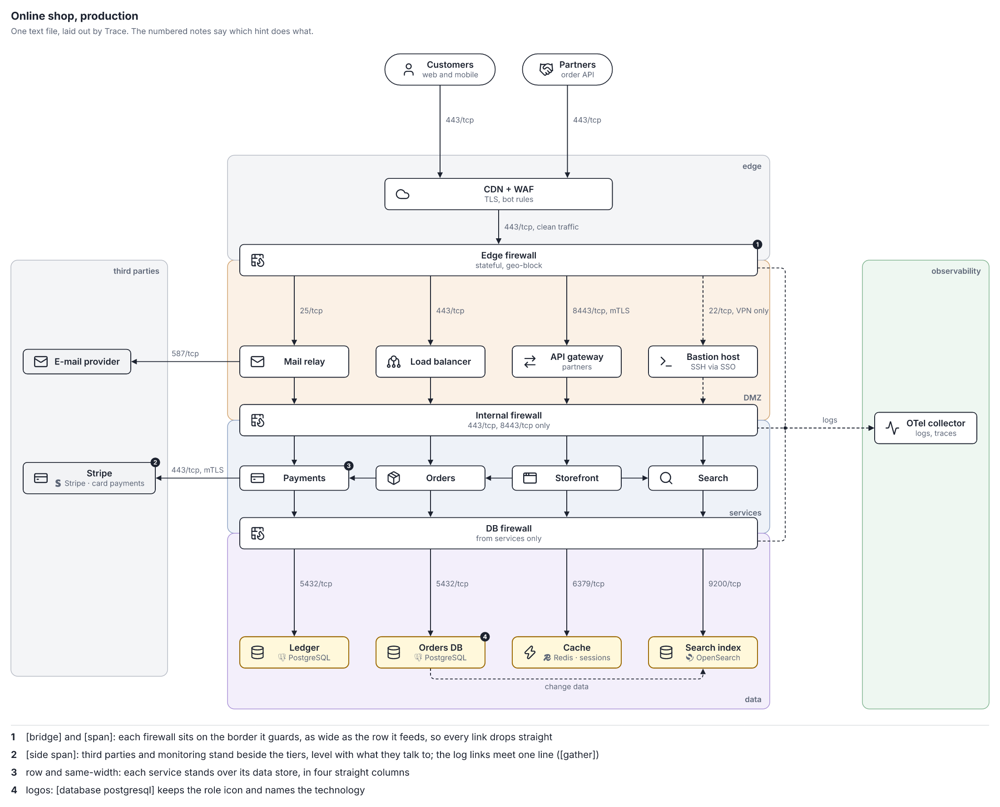

# Trace

Draw architecture and network diagrams from plain text.

Trace is a diagram-as-code tool inspired by Mermaid: you write nodes, links and zones in a text file, and it lays
them out for you.

Mermaid draws what you write, but you can't tell it where things go, so a large diagram often comes out tangled.
Trace lets you add a hint where it matters (this firewall sits on that border, these services go side by side), so
the diagram comes out the way you would have drawn it yourself.

<picture>
  <source media="(prefers-color-scheme: dark)" srcset="docs/images/online-shop.dark.png">
  
</picture>

<!-- source examples/playground/online-shop.trace "The Trace source of this drawing" -->
<details><summary>The Trace source of this drawing</summary>

```
direction down
title "Online shop, production"
caption "One text file, laid out by Trace. The numbered notes say which hint does what."
notes numbered

column {
  row {
    pill users [user]: Customers | web and mobile
    pill partners [handshake]: Partners | order API
  }
  frame edge "edge" [grey] {
    cdn [span cloud]: CDN + WAF | TLS, bot rules
  }
}
frame dmz "DMZ" [orange] {
  fw1 [bridge span firewall]: Edge firewall | stateful, geo-block
  row {
    relay [mail]: Mail relay
    lb [loadbalancer]: Load balancer
    gw [arrow-right-left]: API gateway | partners
    bastion [terminal]: Bastion host | SSH via SSO
  }
}
frame app "services" [blue] {
  fw2 [bridge span firewall]: Internal firewall | 443/tcp, 8443/tcp only
  row {
    pay [credit-card]: Payments
    orders [package]: Orders
    web [browser]: Storefront
    search [search]: Search
  }
}
frame data "data" [purple] {
  fw3 [bridge span firewall]: DB firewall | from services only
  row {
    store ledger [database postgresql]: Ledger
    store pg [database postgresql]: Orders DB
    store redis [zap redis]: Cache | sessions
    store os [database opensearch]: Search index
  }
}
frame third "third parties" [grey side left span] {
  engine mailer [mail]: E-mail provider
  engine stripe [credit-card stripe]: Stripe | card payments
}
frame obs "observability" [green side span] {
  otel [gather activity]: OTel collector | logs, traces
}

users -> cdn : 443/tcp
partners -> cdn : 443/tcp
cdn -> fw1 : 443/tcp, clean traffic
fw1 -> relay : 25/tcp
fw1 -> lb : 443/tcp
fw1 -> gw : 8443/tcp, mTLS
fw1 -> bastion [dashed] : 22/tcp, VPN only
relay -> fw2
lb -> fw2
gw -> fw2
bastion -> fw2 [dashed]
fw2 -> pay
fw2 -> orders
fw2 -> web
fw2 -> search
pay -> fw3
orders -> fw3
web -> fw3
search -> fw3
fw3 -> ledger : 5432/tcp
fw3 -> pg : 5432/tcp
fw3 -> redis : 6379/tcp
fw3 -> os : 9200/tcp
pay <- orders
orders <- web
web -> search
pg --> os : change data
relay -> mailer : 587/tcp
pay -> stripe : 443/tcp, mTLS
fw1 --> otel : logs
fw2 --> otel : logs
fw3 --> otel : logs

same-width relay lb gw bastion pay orders web search ledger pg redis os

note fw1 : [bridge] and [span]: each firewall sits on the border it guards, as wide as the row it feeds, so every link drops straight
note pay : row and same-width: each service stands over its data store, in four straight columns
note stripe : [side span]: third parties and monitoring stand beside the tiers, level with what they talk to; the log links meet one line ([gather])
note pg : logos: [database postgresql] keeps the role icon and names the technology
```

</details>
<!-- /source -->

## Why Trace

- **Without hints, at least as good as Mermaid.** Write nodes and links only, and the automatic layout must read
  at least as well as Mermaid's drawing of the same diagram. This is measured on 27 real diagrams, drawn three ways
  (as written, with hints, and by Mermaid) on the comparison page: `npm run build`, then `dist/compare.html`.
- **With hints, the diagram you had in mind.** Rows and columns, `[span]`, `[bridge]`, side zones, `align`, `mark`,
  `[gather]`, `tree`, notes, icons and logos: each is optional, and each says something the layout cannot guess.

## Text in, diagram out

```
direction down
pill users [user]: Customers
frame dmz "DMZ" [orange] {
  fw [bridge span firewall]: Edge firewall
  lb [loadbalancer]: Load balancer
}
store db [database postgresql]: Orders DB
users -> fw : 443/tcp
fw -> lb
lb -> db : 5432/tcp
note fw : stateful, geo-block
```

Nodes are a name and a label (`a: Label | a note under it`), links are arrows with an optional label, and
everything else is optional: a kind (`state`, `store`, `pill`, `final`…), a tag (`[bad]`, `[dashed]`, an icon
such as `[database]` or a technology logo such as `[postgresql]`), a zone around a group. Orthogonal links,
rounded corners, arrowheads that stop short of the box, hops where two links cross, labels with a halo, light
and dark: the style is built in. The full language is in the [manual](docs/manual.md); twenty real diagrams with
their notes are on the showcase page (`dist/showcase.html`).

## Use it

```
npm install
npm test
node tools/render.js examples/cases/dmz.trace dmz.svg     # or .png; --dark, --zoom 2, --watch
npm run build        # dist/playground.html (live editor), dist/showcase.html (twenty real cases),
                     # dist/features.html (every feature with and without), dist/compare.html (Trace beside Mermaid)
npm run metrics      # layout quality over the examples and a held-out set of real diagrams
npm run build:docs   # the pictures in this README and the docs
```

- [Getting started](docs/getting-started.md): install, your first diagram, the playground, using Trace from code.
- [The manual](docs/manual.md): everything you can write, then how to make a diagram look right.
- [Coming from Mermaid](docs/coming-from-mermaid.md): the same things side by side, and a converter.
- [How it works](docs/how-it-works.md): the layout, step by step, in pictures.
- [Roadmap](ROADMAP.md): what is next.

Icons are Lucide's (ISC) and technology logos Simple Icons' (CC0; the logos are trademarks of their owners),
see `third-party/`.
