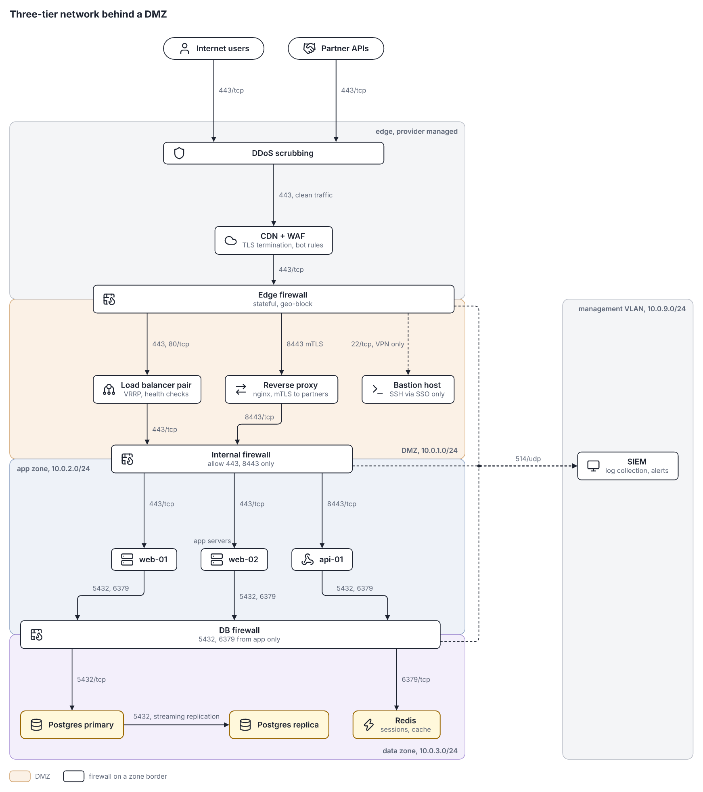
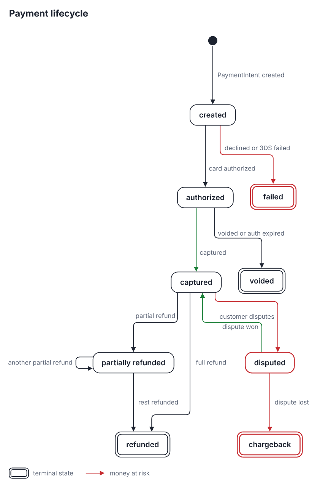
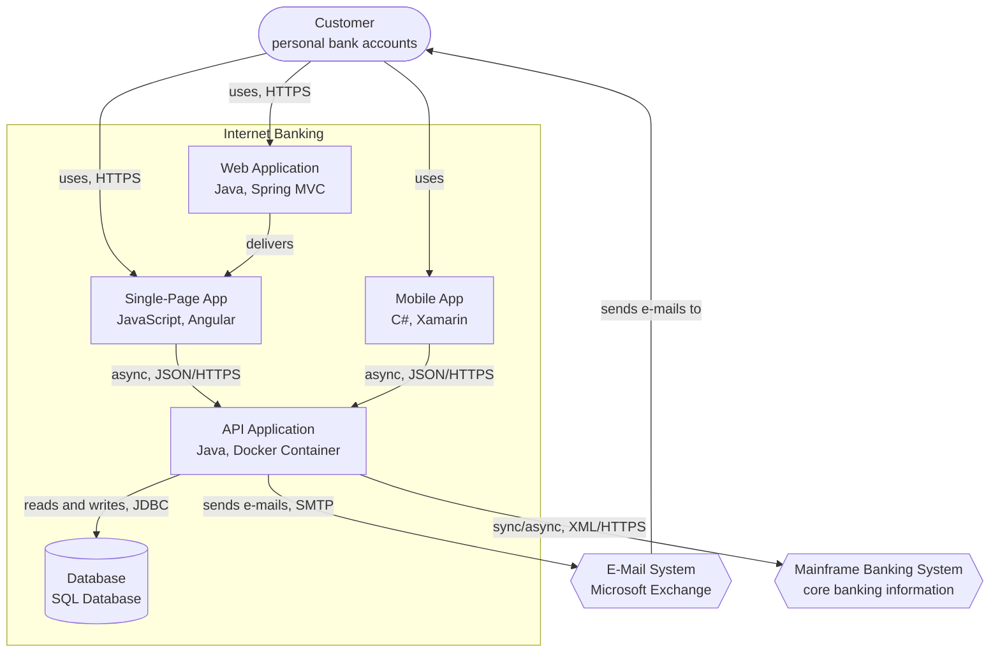
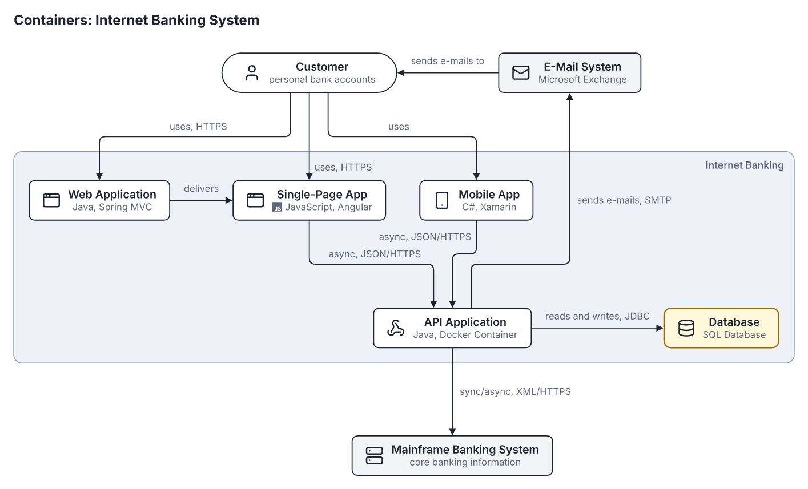
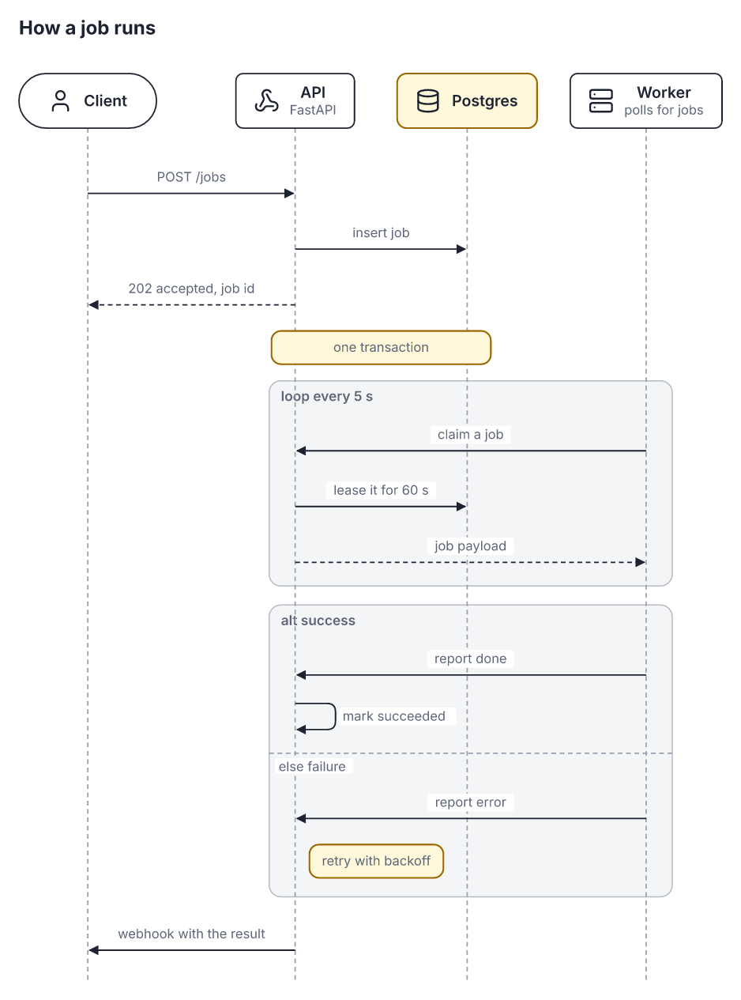

# Trace

Write diagrams as plain text; get them drawn like a careful hand would.

<picture>
  <source media="(prefers-color-scheme: dark)" srcset="docs/images/dmz.dark.png">
  
</picture>

<sub>The 66 lines of text behind this drawing: <a href="examples/cases/dmz.trace"><code>examples/cases/dmz.trace</code></a>.</sub>

Trace keeps what people love in Mermaid (a diagram is code, it is easy to write, and the layout is automatic)
and adds what it lacks to look good. Two promises:

- **With no help, at least as good as Mermaid.** Write nodes and links only and the automatic layout must
  read at least as well as Mermaid's drawing of the same diagram.
- **With a few hints, the next level.** Rows and columns, `[span]`, `[bridge]`, side zones, `align`, `mark`,
  `[join]`, `tree`, icons and logos: each is optional, each says something the engine cannot guess, and
  together they give a drawing a careful hand would make.

## Plain text in, a careful drawing out

<table>
<tr>
<td valign="top">

```
title "Payment lifecycle"
direction down

start s
state created: created
state authorized: authorized
state captured: captured
state partial: partially refunded
state disputed [bad]: disputed
final failed [bad]: failed
final voided: voided
final refunded: refunded
final lost [bad]: chargeback

s -> created : PaymentIntent created
created -> authorized : card authorized
created -> failed [bad] : declined or 3DS failed
authorized -> captured [ok] : captured
authorized -> voided : voided or auth expired
captured -> partial : partial refund
partial -> partial : another partial refund
partial -> refunded : rest refunded
captured -> refunded : full refund
captured -> disputed [bad] : customer disputes
captured <- disputed [ok] : dispute won
disputed -> lost [bad] : dispute lost

key final : terminal state
key -> [bad] : money at risk
```

</td>
<td valign="top">
<picture>
  <source media="(prefers-color-scheme: dark)" srcset="docs/images/payment.dark.png">
  
</picture>
</td>
</tr>
</table>

Nodes are a name and a label (`a: Label | a note under it`), links are arrows with an optional label, and
everything else is optional: a kind (`state`, `store`, `pill`, `final`…), a tag (`[bad]`, `[dashed]`, an icon
such as `[database]` or a technology logo such as `[postgresql]`), a frame around a zone. Orthogonal links,
rounded corners, arrowheads that stop short of the box, hops where two links cross, labels with a halo, light
and dark: the style is built in. The full language is in [`docs/language.md`](docs/language.md).

## The same diagram three ways

The C4 container diagram of the “Internet Banking System”, one of the real diagrams Trace is measured on.
First as Mermaid draws it (GitHub draws this one live from the text):



<table>
<tr>
<th width="50%">Trace, the same nodes and links, no layout help</th>
<th width="50%">Trace, with hints</th>
</tr>
<tr>
<td valign="top">
<picture>
  <source media="(prefers-color-scheme: dark)" srcset="docs/images/bigbank-plain.dark.png">
  
</picture>
</td>
<td valign="top">
<picture>
  <source media="(prefers-color-scheme: dark)" srcset="docs/images/bigbank-full.dark.png">
  
</picture>
</td>
</tr>
<tr>
<td valign="top"><a href="examples/holdout/bigbank-container.trace">source</a>: nodes, links, one frame, a few icons.</td>
<td valign="top"><a href="examples/holdout/full/bigbank-container.trace">source</a>: the same, plus two icons, a <code>row</code> for the
three front ends, a <code>row</code> for the API and its database, and two links written with <code>&lt;-</code>
so the e-mail system stands beside the customer instead of under everything.</td>
</tr>
</table>

Every one of the 27 diagrams in [`examples/holdout/`](examples/holdout/) is drawn these three ways by
`npm run build:compare`, and `npm run metrics` counts what makes a drawing hard to read (links through boxes,
crossings, bends, links along borders, crossed labels). No engine change is kept if those numbers get worse.

## Hints say what the engine cannot guess

A firewall belongs to two zones. Say so with `[bridge]` and it sits on the border it guards; `[span]` makes it
as wide as what it feeds, so every rule drops on a straight line.

```diff
 frame dmz "DMZ" [orange] {
-  fw1: Edge firewall
+  fw1 [bridge span firewall]: Edge firewall
   row {
     lb: Load balancer
     rp: Reverse proxy
   }
 }
```

<table>
<tr><th>Without</th><th>With</th></tr>
<tr>
<td valign="top">
<picture>
  <source media="(prefers-color-scheme: dark)" srcset="docs/images/bridge.before.dark.png">
  
</picture>
</td>
<td valign="top">
<picture>
  <source media="(prefers-color-scheme: dark)" srcset="docs/images/bridge.after.dark.png">
  
</picture>
</td>
</tr>
</table>

Every hint has its before and after in [`docs/layout-guide.md`](docs/layout-guide.md): which rule it serves, why,
and what it changes.

## Gallery

<table>
<tr>
<td width="50%" valign="top">
<picture>
  <source media="(prefers-color-scheme: dark)" srcset="docs/images/cicd.dark.png">
  
</picture>
<br><b>CI/CD with canary releases</b>: one row per stage, three checks joined into one gate, red and green
paths. <a href="examples/cases/cicd.trace">source</a>
</td>
<td width="50%" valign="top">
<picture>
  <source media="(prefers-color-scheme: dark)" srcset="docs/images/job-sequence.dark.png">
  
</picture>
<br><b>Sequence diagram</b>: messages, notes and loops. <a href="examples/playground/job-sequence.trace">source</a>
</td>
</tr>
<tr>
<td colspan="2" valign="top">
<picture>
  <source media="(prefers-color-scheme: dark)" srcset="docs/images/hybrid.dark.png">
  
</picture>
<br><b>Hybrid cloud</b>: four levels of nested zones, subnet tiers with straight sides, a transit gateway on
the AWS border. <a href="examples/cases/hybrid.trace">source</a>
</td>
</tr>
<tr>
<td colspan="2" valign="top">
<picture>
  <source media="(prefers-color-scheme: dark)" srcset="docs/images/shop-model.dark.png">
  
</picture>
<br><b>Data model</b>: tables, each link ending at the row it is about. <a href="examples/cases/shop-model.trace">source</a>
</td>
</tr>
<tr>
<td colspan="2" valign="top">
<picture>
  <source media="(prefers-color-scheme: dark)" srcset="docs/images/orgchart.dark.png">
  
</picture>
<br><b>Org chart</b>: the <code>tree</code> line centres each parent over its children. <a href="examples/cases/orgchart.trace">source</a>
</td>
</tr>
</table>

Twenty real-world cases, each with what Trace uses and what it still lacks: `npm run build`, then open
`dist/showcase.html`.

## Use it

```
npm install
npm test
node tools/render.js examples/cases/dmz.trace dmz.svg     # or .png; --dark, --zoom 2, --watch
npm run build        # dist/playground.html (live editor), dist/showcase.html (twenty real cases),
                     # dist/features.html (every feature with and without), dist/compare.html (Trace beside Mermaid)
npm run metrics      # layout quality over the examples and a held-out set of real diagrams
npm run build:docs   # the pictures in this README and the layout guide
```

Language: [`docs/language.md`](docs/language.md). Drawing a diagram well: [`docs/layout-guide.md`](docs/layout-guide.md).
How it works: [`docs/architecture.md`](docs/architecture.md). The rules behind the layout:
[`docs/drawing-rules.md`](docs/drawing-rules.md). What's next: [`docs/roadmap.md`](docs/roadmap.md).

Icons are Lucide's (ISC) and technology logos Simple Icons' (CC0; the logos are trademarks of their owners),
see `third-party/`.
