# How Trace lays out a diagram

Pictures first: every picture below is drawn by the engine itself (`npm run build:docs`). In each step, what changed is in orange.

## The journey

<table>
<tr><th>1. You write text</th><th>2. ELK places the parts</th><th>3. Trace tidies up</th></tr>
<tr>
<td valign="top">

```
title "CQRS with event sourcing"

client: Client
frame write "write side" [blue] {
  cmd: Command API
  agg: Order aggregate | validates rules
  store events: Event store | append only
}
bus: Event bus
frame read "read side" [green] {
  proj: Projector
  store view: Read model | denormalised
  query: Query API
}
…
```

</td>
<td valign="top">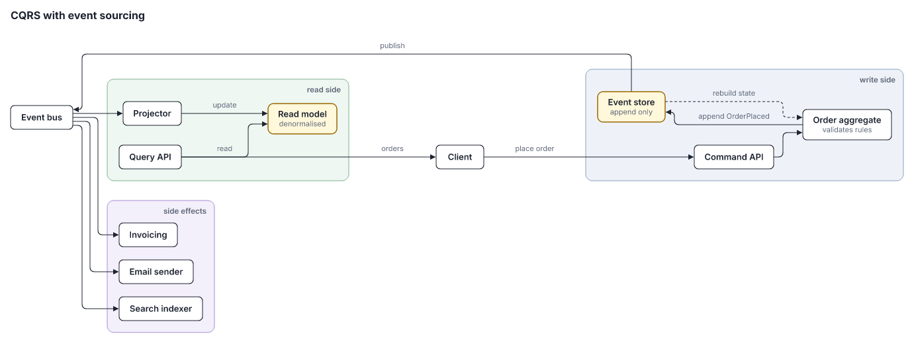</td>
<td valign="top">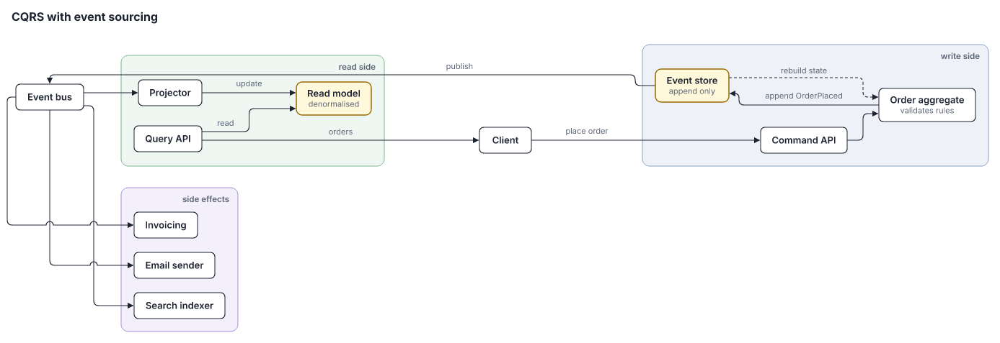</td>
</tr>
</table>

<!-- source examples/cases/simple/cqrs.trace "Trace source of this diagram" -->
<details><summary>Trace source of this diagram</summary>

```
title "CQRS with event sourcing"

client: Client
frame write "write side" [blue] {
  cmd: Command API
  agg: Order aggregate | validates rules
  store events: Event store | append only
}
bus: Event bus
frame read "read side" [green] {
  proj: Projector
  store view: Read model | denormalised
  query: Query API
}
frame side "side effects" [purple] {
  mail: Email sender
  search: Search indexer
  bill: Invoicing
}

client -> cmd : place order
cmd -> agg
agg -> events : append OrderPlaced
events -> bus : publish
bus -> proj
proj -> view : update
query -> client : orders
query -> view : read
bus -> mail
bus -> search
bus -> bill
events -> agg [dashed] : rebuild state
```

</details>
<!-- /source -->

## Inside ELK

ELK (the Eclipse Layout Kernel, layered algorithm) does the first placement, in five phases:

<table>
<tr>
<th>1. Cycles broken</th>
<th>2. Layers</th>
<th>3. Order in each layer</th>
<th>4. Positions</th>
<th>5. Routes</th>
</tr>
<tr>
<td valign="top">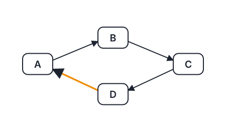</td>
<td valign="top">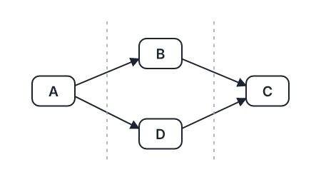</td>
<td valign="top">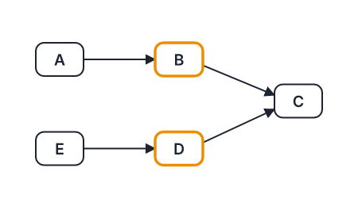</td>
<td valign="top">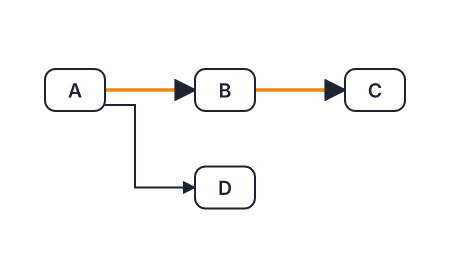</td>
<td valign="top">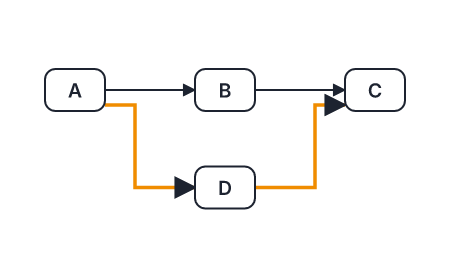</td>
</tr>
<tr>
<td valign="top"><sub>A link that closes a loop is turned round for the layout (its arrow is kept).</sub></td>
<td valign="top"><sub>Every node gets a column, in the order of the flow.</sub></td>
<td valign="top"><sub>Nodes in one column are reordered until links cross least.</sub></td>
<td valign="top"><sub>Nodes are placed so as many links as possible run straight.</sub></td>
<td valign="top"><sub>Links are drawn with right angles between the nodes.</sub></td>
</tr>
</table>

Before ELK, Trace sets the scene: sizes every node, and turns zones, rows and columns into nested boxes for it.

## Trace's tidy-up, step by step

After ELK, the drawing goes through these steps, in this order. Each step is sketched, then shown in a real diagram drawn by the engine.

<!-- step: centreParents -->
### 1. Parents over their children

With `tree`, each parent moves over the middle of its children.

<table>
<tr><th>Before</th><th>After</th></tr>
<tr>
<td valign="top">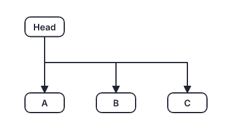</td>
<td valign="top">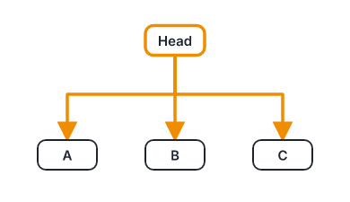</td>
</tr>
</table>

<details><summary>In a real diagram</summary>

<table>
<tr><th>Before</th><th>After</th></tr>
<tr>
<td valign="top">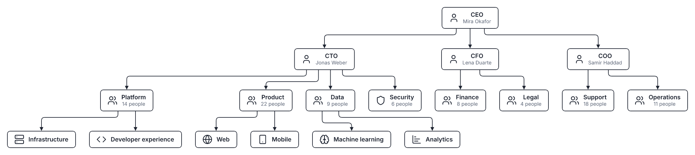</td>
<td valign="top">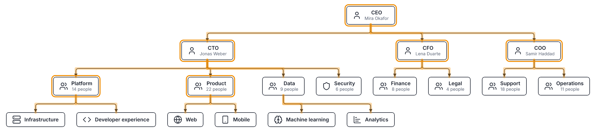</td>
</tr>
</table>

<sub>From [Engineering organisation](#examples-cases-orgchart-trace), the clearest case among the diagrams in `examples/`.</sub>

</details>

<!-- step: placeOnConcentrators -->
### 2. Junctions inside zones

Five or more alike links from one zone meet one line inside it; each runs straight across to it.

<table>
<tr><th>Before</th><th>After</th></tr>
<tr>
<td valign="top">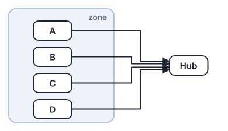</td>
<td valign="top">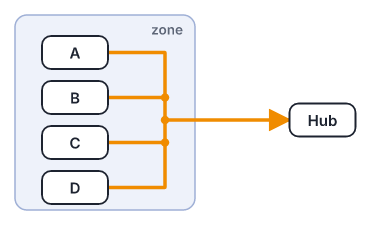</td>
</tr>
</table>

<details><summary>In a real diagram</summary>

<table>
<tr><th>Before</th><th>After</th></tr>
<tr>
<td valign="top">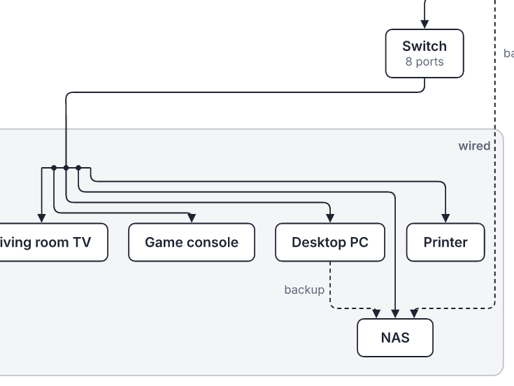</td>
<td valign="top">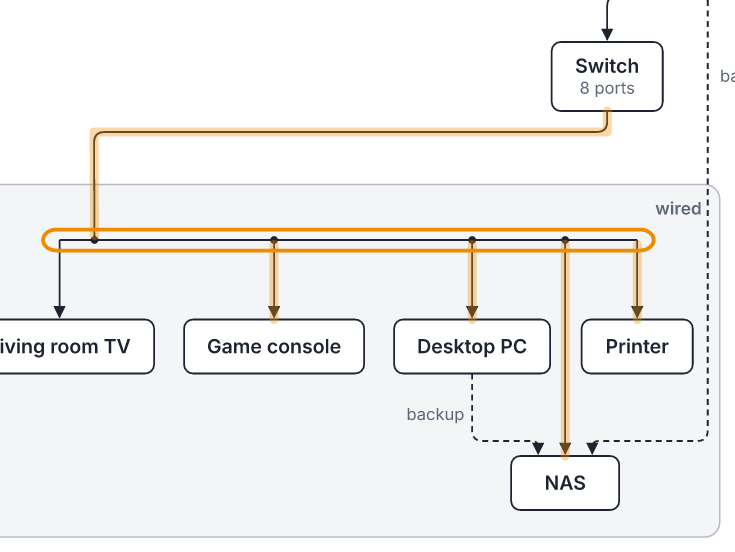</td>
</tr>
</table>

<sub>From [Home network](#examples-cases-simple-home-trace), the clearest case among the diagrams in `examples/`.</sub>

</details>

<!-- step: splitDecisions -->
### 3. Decisions part at the box

A question's yes and no leave from different sides.

<table>
<tr><th>Before</th><th>After</th></tr>
<tr>
<td valign="top">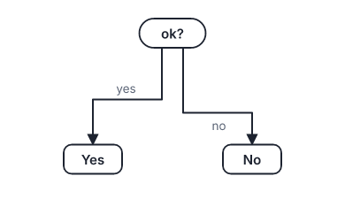</td>
<td valign="top">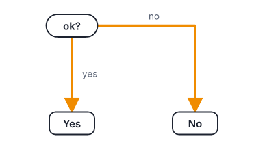</td>
</tr>
</table>

<details><summary>In a real diagram</summary>

<table>
<tr><th>Before</th><th>After</th></tr>
<tr>
<td valign="top">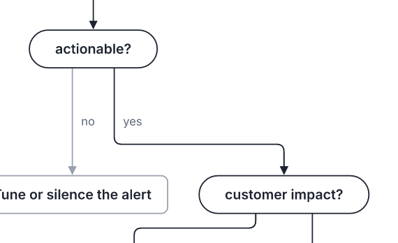</td>
<td valign="top">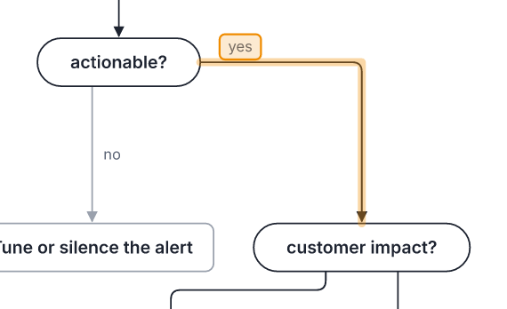</td>
</tr>
</table>

<sub>From [Incident response](#examples-cases-simple-incident-trace), the clearest case among the diagrams in `examples/`.</sub>

</details>

<!-- step: spanSides -->
### 4. Side zones line up

A side zone stretches along the zones it serves; its nodes move level with their links.

<table>
<tr><th>Before</th><th>After</th></tr>
<tr>
<td valign="top">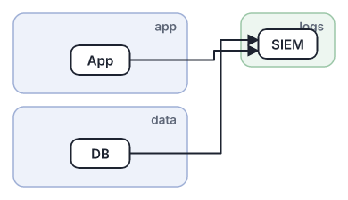</td>
<td valign="top">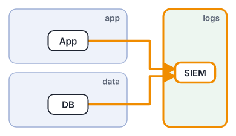</td>
</tr>
</table>

<details><summary>In a real diagram</summary>

<table>
<tr><th>Before</th><th>After</th></tr>
<tr>
<td valign="top">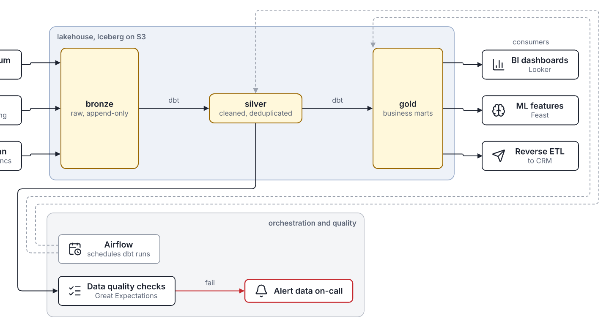</td>
<td valign="top">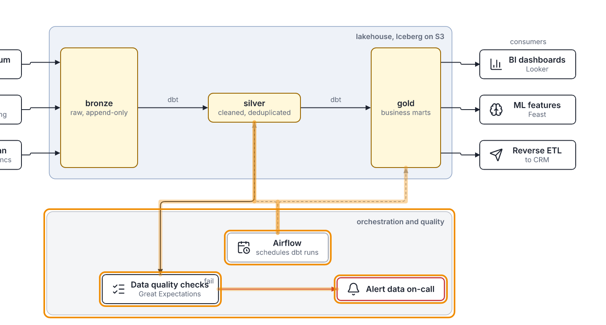</td>
</tr>
</table>

<sub>From [Analytics platform, sources to dashboards](#examples-cases-data-trace), the clearest case among the diagrams in `examples/`.</sub>

</details>

<!-- step: pullSides -->
### 5. Side zones come close

A side zone slides back beside the zones level with it, whatever sticks out elsewhere.

<table>
<tr><th>Before</th><th>After</th></tr>
<tr>
<td valign="top">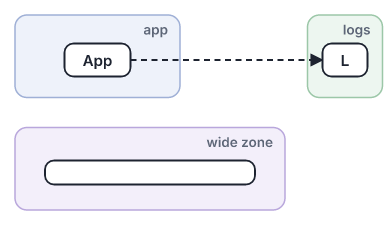</td>
<td valign="top">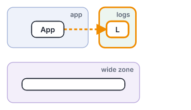</td>
</tr>
</table>

<details><summary>In a real diagram</summary>

<table>
<tr><th>Before</th><th>After</th></tr>
<tr>
<td valign="top">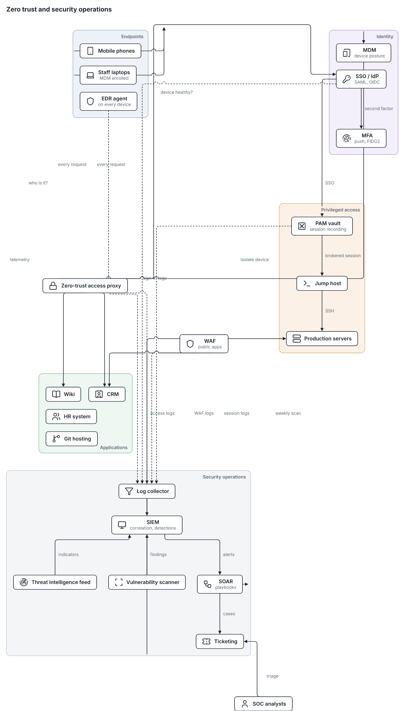</td>
<td valign="top">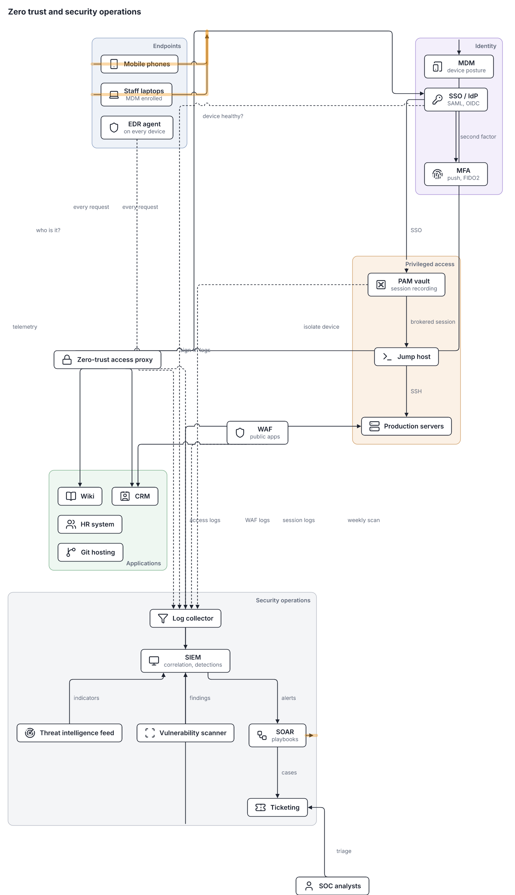</td>
</tr>
</table>

<sub>From [Zero trust and security operations](#examples-holdout-security-operations-trace), the clearest case among the diagrams in `examples/`.</sub>

</details>

<!-- step: clearFrames -->
### 6. Off the borders

A link running along a zone border moves off it.

<table>
<tr><th>Before</th><th>After</th></tr>
<tr>
<td valign="top">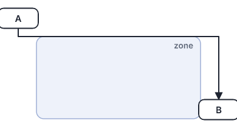</td>
<td valign="top">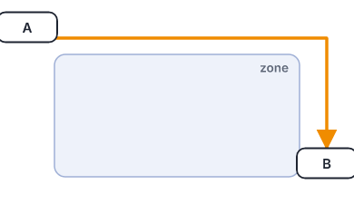</td>
</tr>
</table>

<details><summary>In a real diagram</summary>

<table>
<tr><th>Before</th><th>After</th></tr>
<tr>
<td valign="top">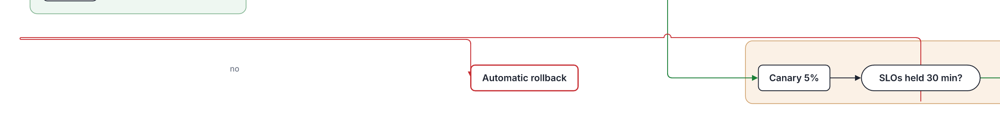</td>
<td valign="top">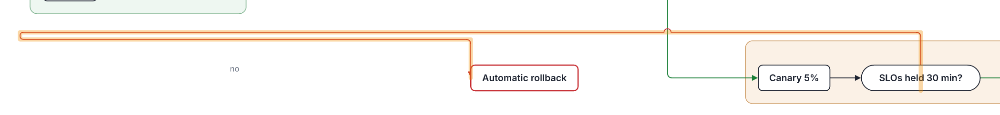</td>
</tr>
</table>

<sub>From [CI/CD with canary releases](#examples-cases-simple-cicd-trace), the clearest case among the diagrams in `examples/`.</sub>

</details>

<!-- step: alignJogs -->
### 7. Steps at one height

Links into one node take their step at the same height.

<table>
<tr><th>Before</th><th>After</th></tr>
<tr>
<td valign="top">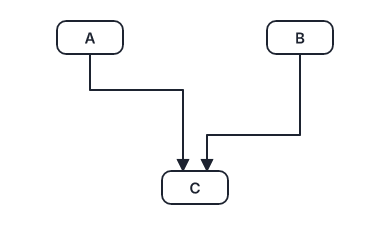</td>
<td valign="top">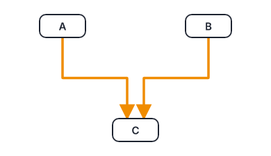</td>
</tr>
</table>

<details><summary>In a real diagram</summary>

<table>
<tr><th>Before</th><th>After</th></tr>
<tr>
<td valign="top">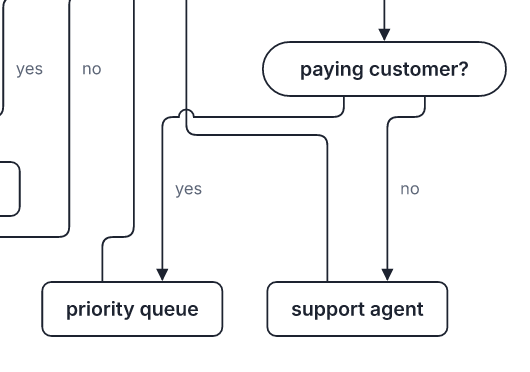</td>
<td valign="top">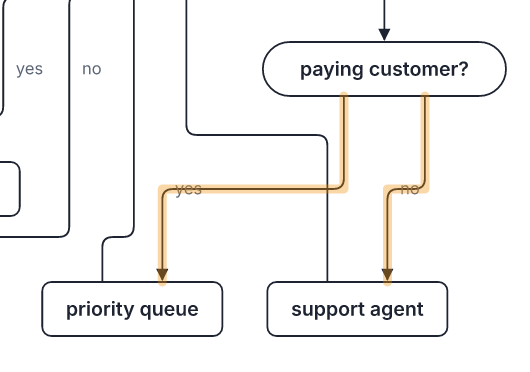</td>
</tr>
</table>

<sub>From [Support ticket triage](#examples-cases-simple-triage-trace), the clearest case among the diagrams in `examples/`.</sub>

</details>

<!-- step: simplifySnakes -->
### 8. No snakes

A link that zigzags more than it needs takes the shorter route.

<table>
<tr><th>Before</th><th>After</th></tr>
<tr>
<td valign="top">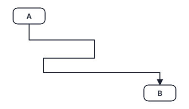</td>
<td valign="top">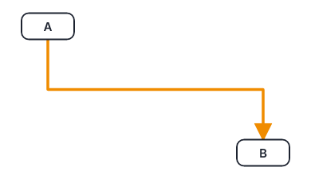</td>
</tr>
</table>

<details><summary>In a real diagram</summary>

<table>
<tr><th>Before</th><th>After</th></tr>
<tr>
<td valign="top">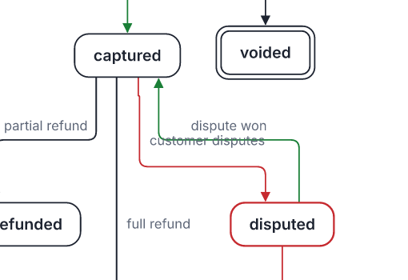</td>
<td valign="top">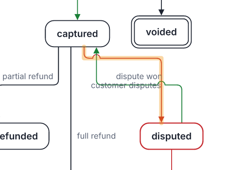</td>
</tr>
</table>

<sub>From [Payment lifecycle](#examples-cases-payment-trace), the clearest case among the diagrams in `examples/`.</sub>

</details>

<!-- step: mergeHubs -->
### 9. Gathered links

Five or more alike links into one node (`gather N` changes the number) become one bus, the label written once.

<table>
<tr><th>Before</th><th>After</th></tr>
<tr>
<td valign="top">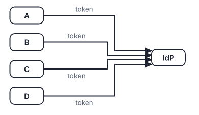</td>
<td valign="top">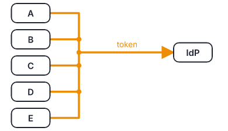</td>
</tr>
</table>

<details><summary>In a real diagram</summary>

<table>
<tr><th>Before</th><th>After</th></tr>
<tr>
<td valign="top">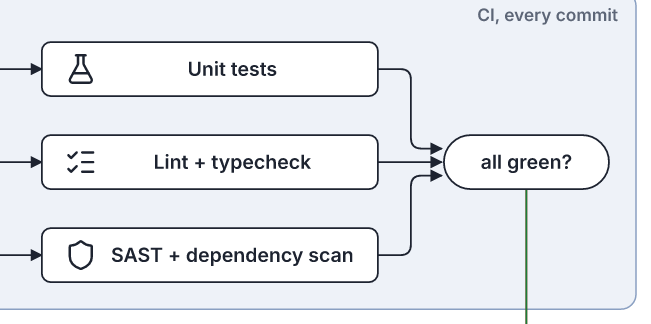</td>
<td valign="top">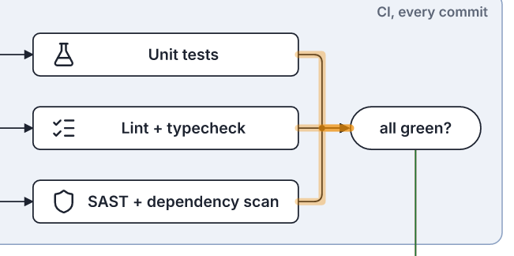</td>
</tr>
</table>

<sub>From [CI/CD with canary releases](#examples-cases-cicd-trace), the clearest case among the diagrams in `examples/`.</sub>

</details>

<!-- step: rerouteBlocked -->
### 10. Around, never through

A link through or along a node, or on top of another link, is routed again on a grid.

<table>
<tr><th>Before</th><th>After</th></tr>
<tr>
<td valign="top">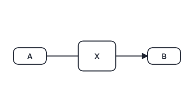</td>
<td valign="top">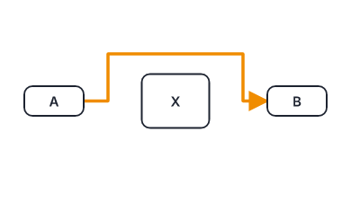</td>
</tr>
</table>

<details><summary>In a real diagram</summary>

<table>
<tr><th>Before</th><th>After</th></tr>
<tr>
<td valign="top">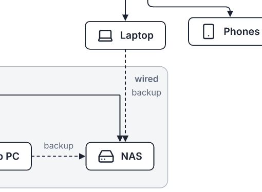</td>
<td valign="top">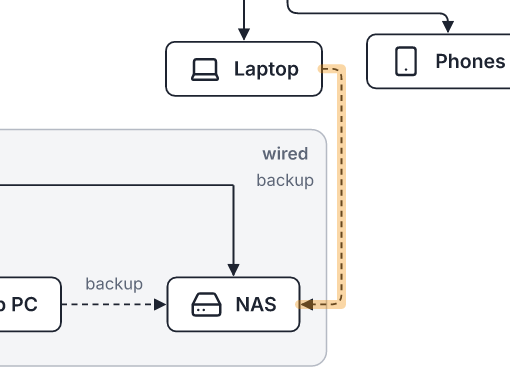</td>
</tr>
</table>

<sub>From [Home network](#examples-cases-home-trace), the clearest case among the diagrams in `examples/`.</sub>

</details>

<!-- step: straightenSmallJogs -->
### 11. Small steps removed

A step of a few pixels is not worth a bend: the end slides and the link is straight.

<table>
<tr><th>Before</th><th>After</th></tr>
<tr>
<td valign="top">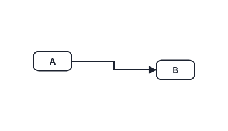</td>
<td valign="top">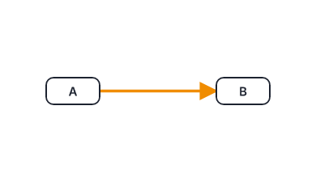</td>
</tr>
</table>

<details><summary>In a real diagram</summary>

<table>
<tr><th>Before</th><th>After</th></tr>
<tr>
<td valign="top">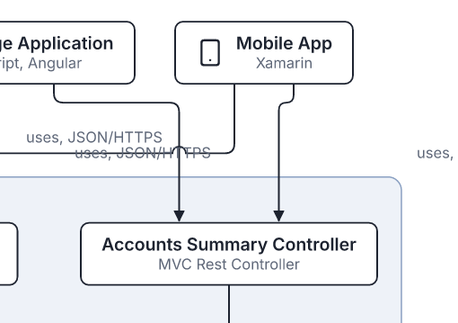</td>
<td valign="top"></td>
</tr>
</table>

<sub>From [Components: API Application](#examples-holdout-bigbank-components-trace), the clearest case among the diagrams in `examples/`.</sub>

</details>

<!-- step: reorderEnds -->
### 12. Ends that do not cross

Links leaving one side of a node take the order that crosses least.

<table>
<tr><th>Before</th><th>After</th></tr>
<tr>
<td valign="top"></td>
<td valign="top"></td>
</tr>
</table>

<details><summary>In a real diagram</summary>

<table>
<tr><th>Before</th><th>After</th></tr>
<tr>
<td valign="top"></td>
<td valign="top"></td>
</tr>
</table>

<sub>From [Payment lifecycle](#examples-cases-payment-trace), the clearest case among the diagrams in `examples/`.</sub>

</details>

<!-- step: spreadEnds -->
### 13. Arrowheads apart

Ends on one side of a node are pushed apart, in the order their links go.

<table>
<tr><th>Before</th><th>After</th></tr>
<tr>
<td valign="top"></td>
<td valign="top"></td>
</tr>
</table>

<details><summary>In a real diagram</summary>

<table>
<tr><th>Before</th><th>After</th></tr>
<tr>
<td valign="top"></td>
<td valign="top"></td>
</tr>
</table>

<sub>From [Kubernetes ingress, service mesh and egress](#examples-cases-simple-k8s-trace), the clearest case among the diagrams in `examples/`.</sub>

</details>

<!-- step: separateParallels -->
### 14. Parallel links apart

Two links running side by side too close are pulled apart.

<table>
<tr><th>Before</th><th>After</th></tr>
<tr>
<td valign="top"></td>
<td valign="top"></td>
</tr>
</table>

<details><summary>In a real diagram</summary>

<table>
<tr><th>Before</th><th>After</th></tr>
<tr>
<td valign="top"></td>
<td valign="top"></td>
</tr>
</table>

<sub>From [Components: API Application](#examples-holdout-bigbank-components-trace), the clearest case among the diagrams in `examples/`.</sub>

</details>

<!-- step: uncrossSteps -->
### 15. Steps swapped

Two links that cross twice swap their steps and cross no more.

<table>
<tr><th>Before</th><th>After</th></tr>
<tr>
<td valign="top"></td>
<td valign="top"></td>
</tr>
</table>

<details><summary>In a real diagram</summary>

<table>
<tr><th>Before</th><th>After</th></tr>
<tr>
<td valign="top"></td>
<td valign="top"></td>
</tr>
</table>

<sub>From [File services and backup, 3-2-1](#examples-holdout-file-backup-trace), the clearest case among the diagrams in `examples/`.</sub>

</details>

<!-- step: resolveOverlaps -->
### 16. Nothing on top

Links still lying on top of each other are separated.

<table>
<tr><th>Before</th><th>After</th></tr>
<tr>
<td valign="top"></td>
<td valign="top"></td>
</tr>
</table>

<details><summary>In a real diagram</summary>

<table>
<tr><th>Before</th><th>After</th></tr>
<tr>
<td valign="top"></td>
<td valign="top"></td>
</tr>
</table>

<sub>From [Microservices sharing one identity provider](#examples-cases-simple-hub-trace), the clearest case among the diagrams in `examples/`.</sub>

</details>

<!-- step: slideToStraighten -->
### 17. Nodes slide to their links

A node whose links all arrive with a short step slides so they arrive straight.

<table>
<tr><th>Before</th><th>After</th></tr>
<tr>
<td valign="top"></td>
<td valign="top"></td>
</tr>
</table>

<details><summary>In a real diagram</summary>

<table>
<tr><th>Before</th><th>After</th></tr>
<tr>
<td valign="top"></td>
<td valign="top"></td>
</tr>
</table>

<sub>From [CQRS with event sourcing](#examples-cases-simple-cqrs-trace), the clearest case among the diagrams in `examples/`.</sub>

</details>

<!-- step: rerouteSiblings -->
### 18. A second look

A link crossing a sibling of its own node is routed again, kept only if it crosses less.

<table>
<tr><th>Before</th><th>After</th></tr>
<tr>
<td valign="top"></td>
<td valign="top"></td>
</tr>
</table>

<details><summary>In a real diagram</summary>

<table>
<tr><th>Before</th><th>After</th></tr>
<tr>
<td valign="top"></td>
<td valign="top"></td>
</tr>
</table>

<sub>From [Branch office LAN with dual ISPs](#examples-cases-simple-office-trace), the clearest case among the diagrams in `examples/`.</sub>

</details>

<!-- step: squareUp -->
### 19. Square

Every stretch is made exactly horizontal or vertical.

<table>
<tr><th>Before</th><th>After</th></tr>
<tr>
<td valign="top"></td>
<td valign="top"></td>
</tr>
</table>

<sub>No diagram in `examples/` shows it visibly at the moment.</sub>

<!-- step: placeLabels -->
### 20. Labels placed

Each label goes beside its link where it covers nothing.

<table>
<tr><th>Before</th><th>After</th></tr>
<tr>
<td valign="top"></td>
<td valign="top"></td>
</tr>
</table>

<details><summary>In a real diagram</summary>

<table>
<tr><th>Before</th><th>After</th></tr>
<tr>
<td valign="top"></td>
<td valign="top"></td>
</tr>
</table>

<sub>From [Analytics platform, sources to dashboards](#examples-cases-data-trace), the clearest case among the diagrams in `examples/`.</sub>

</details>

<!-- step: roomForTitles -->
### 21. Room for titles

A zone with no free corner grows a band for its title.

<table>
<tr><th>Before</th><th>After</th></tr>
<tr>
<td valign="top"></td>
<td valign="top"></td>
</tr>
</table>

<details><summary>In a real diagram</summary>

<table>
<tr><th>Before</th><th>After</th></tr>
<tr>
<td valign="top"></td>
<td valign="top"></td>
</tr>
</table>

<sub>From [Production Kubernetes platform](#examples-holdout-k8s-platform-trace), the clearest case among the diagrams in `examples/`.</sub>

</details>

<!-- step: alignTitleEdges -->
### 22. Titles in line

Zones side by side put their titles on the same edge.

<table>
<tr><th>Before</th><th>After</th></tr>
<tr>
<td valign="top"></td>
<td valign="top"></td>
</tr>
</table>

<details><summary>In a real diagram</summary>

<table>
<tr><th>Before</th><th>After</th></tr>
<tr>
<td valign="top"></td>
<td valign="top"></td>
</tr>
</table>

<sub>From [Home network: UniFi, four VLANs](#examples-holdout-unifi-home-vlans-trace), the clearest case among the diagrams in `examples/`.</sub>

</details>

<!-- step: sameSizeFrames -->
### 23. Same size

Zones written `same-width` or `same-height` grow to one size.

<table>
<tr><th>Before</th><th>After</th></tr>
<tr>
<td valign="top"></td>
<td valign="top"></td>
</tr>
</table>

<sub>No diagram in `examples/` shows it visibly at the moment.</sub>

<!-- step: fitCanvas -->
### 24. Cut to size

The drawing is cut to what it holds, with a margin.

<table>
<tr><th>Before</th><th>After</th></tr>
<tr>
<td valign="top"></td>
<td valign="top"></td>
</tr>
</table>

<details><summary>In a real diagram</summary>

<table>
<tr><th>Before</th><th>After</th></tr>
<tr>
<td valign="top"></td>
<td valign="top"></td>
</tr>
</table>

<sub>From [Job states](#examples-playground-job-states-trace), the clearest case among the diagrams in `examples/`.</sub>

</details>

## The diagrams used

<a id="examples-cases-data-trace"></a>
**Analytics platform, sources to dashboards** (`examples/cases/data.trace`)

<!-- source examples/cases/data.trace -->
<details><summary>Trace source</summary>

```
title "Analytics platform, sources to dashboards"

column "sources" {
  store app [database]: App Postgres
  logs [mouse-pointer-click]: Clickstream | via Kafka
  saas [cloud]: SaaS tools | Salesforce, Stripe, Zendesk
}

column "ingestion" {
  debezium [database-zap]: Debezium | CDC
  flink [waves]: Flink | streaming
  fivetran [refresh-cw]: Fivetran | hourly syncs
}

frame lake "lakehouse, Iceberg on S3" [blue] {
  store bronze [span]: bronze | raw, append-only
  store silver: silver | cleaned, deduplicated
  store gold [span]: gold | business marts
}

column "consumers" {
  bi [chart]: BI dashboards | Looker
  ml [brain]: ML features | Feast
  rev [send]: Reverse ETL | to CRM
}

frame ops "orchestration and quality" [grey side span] {
  airflow [muted calendar-clock]: Airflow | schedules dbt runs
  dq [list-checks]: Data quality checks | Great Expectations
  alert [bad bell]: Alert data on-call
}

app -> debezium
logs -> flink
saas -> fivetran
debezium -> bronze
flink -> bronze
fivetran -> bronze
bronze -> silver : dbt
silver -> gold : dbt
gold -> bi
gold -> ml
gold -> rev
silver -> dq
dq -> alert [bad] : fail
airflow --> silver [muted]
airflow --> gold [muted]
```

</details>
<!-- /source -->

<a id="examples-cases-simple-office-trace"></a>
**Branch office LAN with dual ISPs** (`examples/cases/simple/office.trace`)

<!-- source examples/cases/simple/office.trace -->
<details><summary>Trace source</summary>

```
title "Branch office LAN with dual ISPs"
direction down

pill isp1: ISP A | fiber 1 Gb
pill isp2: ISP B | LTE backup

frame edge "edge" [orange] {
  r1: Edge router A
  r2: Edge router B
  fw: Firewall HA pair | active / passive
}

frame core "core" [blue] {
  coresw: Core switch stack | L3, inter-VLAN routing
}

frame access "access layer" [green] {
  staff: VLAN 10 | staff
  voip: VLAN 20 | VoIP phones
  iot: VLAN 40 | printers, cameras
  guest [dashed]: VLAN 30 | guest, internet only
}

frame sec "security services" [purple] {
  proxy: Web proxy | TLS inspection, category filter
  nac: NAC | 802.1X, RADIUS
}

isp1 -> r1 : BGP 179/tcp, 1 Gb
isp2 --> r2 : LTE, IPsec 4500/udp
r1 -> fw : VLAN 100
r2 --> fw : VLAN 101
fw -> coresw : 802.1Q trunk
coresw -> staff : VLAN 10
coresw -> voip : VLAN 20, SIP 5060/udp
coresw -> guest : VLAN 30
coresw -> iot : VLAN 40
staff -> proxy : 3128/tcp web traffic
proxy -> fw : 443/tcp inspected egress
guest -> fw [dashed] : 80/tcp, 443/tcp straight out, isolated
nac -> staff [muted] : RADIUS 1812/udp, assigns VLAN

key box [dashed] : isolated VLAN
```

</details>
<!-- /source -->

<a id="examples-cases-simple-cicd-trace"></a>
**CI/CD with canary releases** (`examples/cases/simple/cicd.trace`)

<!-- source examples/cases/simple/cicd.trace -->
<details><summary>Trace source</summary>

```
title "CI/CD with canary releases"

dev: Developer push
frame ci "CI, every commit" [blue] {
  build: Build | cached Docker layers
  unit: Unit tests
  lint: Lint + typecheck
  sast: SAST + dependency scan
  ask gate: all green?
}
store registry: Image registry | signed with cosign
frame staging "staging" [green] {
  deploy: Deploy | Helm
  e2e: E2E + smoke tests
}
ask approve: release approved?
frame prod "production" [orange] {
  canary: Canary 5%
  ask slo: SLOs held 30 min?
  full [ok]: Roll out 100%
}
rollback [bad]: Automatic rollback

dev -> build
build -> unit
build -> lint
build -> sast
unit -> gate
lint -> gate
sast -> gate
gate -> dev [bad] : no, PR blocked
gate -> registry [ok] : yes, push
registry -> deploy -> e2e -> approve
approve -> canary [ok] : yes
canary -> slo
slo -> full [ok] : yes
slo -> rollback [bad] : no

align registry deploy e2e approve
align slo rollback
```

</details>
<!-- /source -->

<a id="examples-cases-cicd-trace"></a>
**CI/CD with canary releases** (`examples/cases/cicd.trace`)

<!-- source examples/cases/cicd.trace -->
<details><summary>Trace source</summary>

```
title "CI/CD with canary releases"

column {
  row {
    dev [user]: Developer push
    frame ci "CI, every commit" [blue] {
      build [span container]: Build | cached Docker layers
      column {
        unit [flask-conical]: Unit tests
        lint [list-checks]: Lint + typecheck
        sast [shield]: SAST + dependency scan
      }
      ask gate [join]: all green?
    }
  }
  row {
    store registry [package]: Image registry | signed with cosign
    frame staging "staging" [green] {
      deploy [rocket]: Deploy | Helm
      e2e [monitor-check]: E2E + smoke tests
    }
    ask approve: release approved?
  }
  column {
    frame prod "production" [orange] {
      canary [bird]: Canary 5%
      ask slo: SLOs held 30 min?
      full [ok server]: Roll out 100%
    }
    rollback [bad undo-2]: Automatic rollback
  }
}

dev -> build
build -> unit
build -> lint
build -> sast
unit -> gate
lint -> gate
sast -> gate
dev <- gate [bad] : no, PR blocked
gate -> registry [ok] : yes, push
registry -> deploy -> e2e -> approve
approve -> canary [ok] : yes
canary -> slo
slo -> full [ok] : yes
slo -> rollback [bad] : no

align registry deploy e2e approve
align slo rollback
```

</details>
<!-- /source -->

<a id="examples-holdout-bigbank-components-trace"></a>
**Components: API Application** (`examples/holdout/bigbank-components.trace`)

<!-- source examples/holdout/bigbank-components.trace -->
<details><summary>Trace source</summary>

```
# Adapted from C4-PlantUML, samples/C4_Component Diagram Sample - bigbankplc.puml (MIT)
direction down
title "Components: API Application"

spa: Single Page Application | JavaScript, Angular
ma [mobile]: Mobile App | Xamarin
store db [database]: Database | relational schema
engine mbs: Mainframe Banking System | core banking information

frame api "API Application" [blue] {
  sign: Sign In Controller | MVC Rest Controller
  accounts: Accounts Summary Controller | MVC Rest Controller
  security [lock]: Security Component | Spring Bean
  facade: Mainframe Banking System Facade | Spring Bean
}

sign -> security : uses
accounts -> facade : uses
security -> db : read and write, JDBC
facade -> mbs : uses, XML/HTTPS
spa -> sign : uses, JSON/HTTPS
spa -> accounts : uses, JSON/HTTPS
ma -> sign : uses, JSON/HTTPS
ma -> accounts : uses, JSON/HTTPS
```

</details>
<!-- /source -->

<a id="examples-cases-simple-cqrs-trace"></a>
**CQRS with event sourcing** (`examples/cases/simple/cqrs.trace`)

<!-- source examples/cases/simple/cqrs.trace -->
<details><summary>Trace source</summary>

```
title "CQRS with event sourcing"

client: Client
frame write "write side" [blue] {
  cmd: Command API
  agg: Order aggregate | validates rules
  store events: Event store | append only
}
bus: Event bus
frame read "read side" [green] {
  proj: Projector
  store view: Read model | denormalised
  query: Query API
}
frame side "side effects" [purple] {
  mail: Email sender
  search: Search indexer
  bill: Invoicing
}

client -> cmd : place order
cmd -> agg
agg -> events : append OrderPlaced
events -> bus : publish
bus -> proj
proj -> view : update
query -> client : orders
query -> view : read
bus -> mail
bus -> search
bus -> bill
events -> agg [dashed] : rebuild state
```

</details>
<!-- /source -->

<a id="examples-cases-orgchart-trace"></a>
**Engineering organisation** (`examples/cases/orgchart.trace`)

<!-- source examples/cases/orgchart.trace -->
<details><summary>Trace source</summary>

```
direction down
tree
title "Engineering organisation"

ceo [user]: CEO | Mira Okafor
cto [user]: CTO | Jonas Weber
cfo [user]: CFO | Lena Duarte
coo [user]: COO | Samir Haddad

platform [users]: Platform | 14 people
product [users]: Product | 22 people
data [users]: Data | 9 people
security [shield]: Security | 6 people
finance [users]: Finance | 8 people
legal [users]: Legal | 4 people
support [users]: Support | 18 people
ops [users]: Operations | 11 people

infra [server]: Infrastructure
dev [code]: Developer experience
web [globe]: Web
mobile [smartphone]: Mobile
ml [brain]: Machine learning
bi [chart-bar]: Analytics

ceo -> cto
ceo -> cfo
ceo -> coo
cto -> platform
cto -> product
cto -> data
cto -> security
cfo -> finance
cfo -> legal
coo -> support
coo -> ops
platform -> infra
platform -> dev
product -> web
product -> mobile
data -> ml
data -> bi
```

</details>
<!-- /source -->

<a id="examples-holdout-file-backup-trace"></a>
**File services and backup, 3-2-1** (`examples/holdout/file-backup.trace`)

<!-- source examples/holdout/file-backup.trace -->
<details><summary>Trace source</summary>

```
# Written for Trace, modelled on a common small-business file and backup setup (NAS shares, hypervisor cluster, backup server, immutable object storage, offsite copy over VPN, disaster-recovery site); frozen at its first draft
title "File services and backup, 3-2-1"

frame office "Main office" [blue] {
  users [users]: Staff PCs
  frame cluster "Hypervisor cluster" [grey] {
    hv1 [server]: Host 1
    hv2 [server]: Host 2
    hv3 [server]: Host 3
  }
  store san [hard-drive]: Shared storage | iSCSI
  store nas [hard-drive]: NAS | SMB shares, hourly snapshots
  backup [archive]: Backup server | jobs, catalogue
  store repo [hard-drive]: Backup repository | local disks, 14 days
  router [router]: Office router | site-to-site VPN
}

frame cloud "Cloud" [orange] {
  store s3 [cloud]: Object storage | immutable, 90 days
  sync [refresh-cw]: File sync service | M365
}

frame dr "DR site" [purple] {
  router2 [router]: DR router
  drhost [server]: Standby host
  store drnas [hard-drive]: DR NAS | replica
}

admin [user]: IT admin
monitor [bell]: Monitoring | backup alerts

users -> nas : SMB
users -> sync : OneDrive
hv1 -> san : iSCSI
hv2 -> san : iSCSI
hv3 -> san : iSCSI
backup -> hv1 : VM snapshots
backup -> hv2 : VM snapshots
backup -> hv3 : VM snapshots
backup -> nas : file backup
backup -> repo : copy 1
backup -> s3 : copy 2, nightly
nas -> drnas : replication, hourly
router -- router2 : IPsec VPN
drnas -> drhost : restore target
admin -> backup : restore tests
backup -> monitor [dashed] : job status
sync -> s3 [dashed] : retention copy
```

</details>
<!-- /source -->

<a id="examples-cases-simple-home-trace"></a>
**Home network** (`examples/cases/simple/home.trace`)

<!-- source examples/cases/simple/home.trace -->
<details><summary>Trace source</summary>

```
direction down
title "Home network"

pill isp: Fiber ISP | 1 Gb
router: Router | firewall, DHCP, DNS
switch: Switch | 8 ports
ap: Access point
frame wired "wired" [grey] {
  printer: Printer
  tv: Living room TV
  console: Game console
  pc: Desktop PC
  nas: NAS
}
laptop: Laptop
phone: Phones
cam: Cameras
lamp: Smart lights
pihole: Pi-hole | ad blocking

isp -> router
router -> switch
router -> ap
router -> pihole : DNS 53/udp
switch -> nas
switch -> printer
switch -> tv
switch -> console
switch -> pc
ap -> laptop
ap -> phone
ap -> cam
ap -> lamp
pc -> nas [dashed] : backup
laptop -> nas [dashed] : backup
```

</details>
<!-- /source -->

<a id="examples-cases-home-trace"></a>
**Home network** (`examples/cases/home.trace`)

<!-- source examples/cases/home.trace -->
<details><summary>Trace source</summary>

```
direction down
title "Home network"

pill isp [internet]: Fiber ISP | 1 Gb
router [router]: Router | firewall, DHCP, DNS
switch [network]: Switch | 8 ports
ap [wifi]: Access point
frame wired "wired" [grey] {
  row {
    printer [printer]: Printer
    tv [tv]: Living room TV
    console [gamepad-2]: Game console
    pc [monitor]: Desktop PC
    nas [hard-drive]: NAS
  }
}
laptop [laptop]: Laptop
phone [smartphone]: Phones
cam [camera]: Cameras
lamp [lightbulb]: Smart lights
pihole [shield]: Pi-hole | ad blocking

isp -> router
router -> switch
router -> ap
router -> pihole : DNS 53/udp
switch -> nas
switch -> printer
switch -> tv
switch -> console
switch -> pc
ap -> laptop
ap -> phone
ap -> cam
ap -> lamp
pc -> nas [dashed] : backup
laptop -> nas [dashed] : backup
```

</details>
<!-- /source -->

<a id="examples-holdout-unifi-home-vlans-trace"></a>
**Home network: UniFi, four VLANs** (`examples/holdout/unifi-home-vlans.trace`)

<!-- source examples/holdout/unifi-home-vlans.trace -->
<details><summary>Trace source</summary>

```
# Adapted from romvek/home-network-diagram, diagrams/network.mmd (MIT); converted with tools/mermaid-to-trace.js, original in unifi-home-vlans.mmd
title "Home network: UniFi, four VLANs"
direction down

pill ISP [internet]: ISP Fiber Modem / ONT | WAN handoff
UDM [router]: UniFi Dream Machine SE | Router · Firewall · IDS/IPS · Controller\nVLAN_TRUSTED · YOUR_TRUSTED_SUBNET
frame CORE "Core switching" [blue] {
  USW [switch]: USW-24-G2 | 24-port · PoE+ · VLAN trunk
  FM1 [switch]: "Flex Mini #1" | 5-port cluster A
  FM2 [switch]: "Flex Mini #2" | 5-port cluster B
}
frame WIFI "Wi-Fi — 2× U7 Pro (Wi-Fi 7 · 2.4 / 5 / 6 GHz)" [blue] {
  SSID1 [wifi]: Trusted 2.4 GHz | VLAN_TRUSTED · YOUR_TRUSTED_SUBNET
  SSID2 [wifi]: Trusted 5 GHz | VLAN_TRUSTED · YOUR_TRUSTED_SUBNET
  SSID3 [wifi]: IoT SSID | VLAN_IOT · YOUR_IOT_SUBNET
  SSID4 [wifi]: Kids SSID | VLAN_KIDS · YOUR_KIDS_SUBNET
}
frame VLAN1W "VLAN_TRUSTED — wireless" [purple] {
  PH [smartphone]: Phones
  LAP [laptop]: Laptops
}
frame VLAN65W "VLAN_IOT — IoT wireless" [orange] {
  ECH [speaker]: Echo speakers
  WLED [lightbulb]: WLED strips
  CAM [camera]: IP cameras
  PLUG [plug]: Smart plugs
}
frame VLAN64W "VLAN_KIDS — Kids" [orange] {
  KIDS [tablet]: Kids devices
}
frame VLAN1W2 "VLAN_TRUSTED — wired" [purple] {
  PC [monitor]: Desktop PC
  ATV [tv]: Apple TV
  CON [gamepad-2]: Gaming console
  TV [tv]: Smart TV
}
frame VLAN62 "VLAN_SERVERS — Secure Server Net · YOUR_SERVER_SUBNET" [green] {
  NAS [hard-drive]: NAS / home server
}
frame VLAN65W2 "VLAN_IOT — IoT wired" [orange] {
  HUE [lightbulb]: Philips Hue bridge
}

ISP -> UDM : WAN
USW -> FM1 : trunk
USW -> FM2 : trunk
UDM -> USW : trunk all VLANs
UDM -> WIFI : VLAN-tagged SSIDs
SSID1 -> PH
SSID2 -> LAP
SSID3 -> ECH
SSID3 -> WLED
SSID3 -> CAM
SSID3 -> PLUG
SSID4 -> KIDS
FM1 -> PC
FM1 -> NAS
FM2 -> ATV
FM2 -> CON
FM2 -> TV
USW -> HUE
```

</details>
<!-- /source -->

<a id="examples-cases-simple-incident-trace"></a>
**Incident response** (`examples/cases/simple/incident.trace`)

<!-- source examples/cases/simple/incident.trace -->
<details><summary>Trace source</summary>

```
title "Incident response"
direction down

alert: Alert fires | SLO burn rate
ask real: actionable?
tune [muted]: Tune or silence the alert
ask sev: customer impact?
sev3: SEV-3 | fix in business hours
page: Page on-call | PagerDuty, 5 min ack
ask ack: acknowledged?
escalate [bad]: Escalate | secondary, then manager
ic: Declare incident | commander, Slack channel
status [muted]: Status page | every 30 min
mitigate: Mitigate | rollback, failover, flag
ask fixed: impact over?
review [ok]: Postmortem | within 5 days, blameless

alert -> real
real -> tune [muted] : no
real -> sev : yes
sev -> sev3 : none
sev -> page : yes
page -> ack
ack -> escalate [bad] : no
escalate -> ic
ack -> ic : yes
ic -> status [muted dashed]
ic -> mitigate
mitigate -> fixed
fixed -> mitigate : no, next option
fixed -> review [ok] : yes
```

</details>
<!-- /source -->

<a id="examples-playground-job-states-trace"></a>
**Job states** (`examples/playground/job-states.trace`)

<!-- source examples/playground/job-states.trace -->
<details><summary>Trace source</summary>

```
title "Job states"
direction down

start begin
state queued: queued
state running: running
final cancelled: cancelled
final succeeded [ok]: succeeded
final failed [bad]: failed

begin -> queued : created with attempt 1
queued -> running : first attempt claimed
queued -> cancelled : cancel
queued -> failed : backend unavailable, no alternative after the grace
running -> running : attempt failed, next attempt queued
running -> succeeded [ok] : attempt succeeded
running -> failed [bad] : last attempt failed, no next backend
running -> cancelled : cancel

key final : terminal state
```

</details>
<!-- /source -->

<a id="examples-cases-simple-k8s-trace"></a>
**Kubernetes ingress, service mesh and egress** (`examples/cases/simple/k8s.trace`)

<!-- source examples/cases/simple/k8s.trace -->
<details><summary>Trace source</summary>

```
title "Kubernetes ingress, service mesh and egress"

pill client: Clients
clb: Cloud load balancer | L4, public IP

frame cluster "cluster prod-eu-1" [blue] {
  frame ingressns "namespace ingress" [grey] {
    ingress: Ingress controller | nginx, cert-manager TLS
  }
  frame shop "namespace shop" [green] {
    svcweb: svc/web
    svccart: svc/cart
    svccat: svc/catalog
    podweb: web × 3
    podcart: cart × 2
    podcat: catalog × 2
  }
  frame datans "namespace data" [purple] {
    store redis: Redis
    store pg: Postgres operator | 3 replicas
  }
  frame egressns "namespace egress" [orange] {
    egw: Egress gateway | allow-list
  }
}
engine stripe: Stripe API
engine smtp: SMTP relay

client -> clb : 443/tcp
clb -> ingress : 443/tcp, NodePort 30443/tcp
ingress -> svcweb : / 8080/tcp
ingress -> svccart : /cart 8080/tcp
ingress -> svccat : /api/catalog 8080/tcp
svcweb -> podweb : 8080/tcp, mTLS
svccart -> podcart : 8080/tcp, mTLS
svccat -> podcat : 8080/tcp, mTLS
podcart -> redis : 6379/tcp
podcat -> pg : 5432/tcp
podcart -> egw [dashed] : 15443/tcp, mesh egress
egw -> stripe : 443/tcp only
egw -> smtp : 587/tcp STARTTLS

align podcart redis
```

</details>
<!-- /source -->

<a id="examples-cases-simple-hub-trace"></a>
**Microservices sharing one identity provider** (`examples/cases/simple/hub.trace`)

<!-- source examples/cases/simple/hub.trace -->
<details><summary>Trace source</summary>

```
title "Microservices sharing one identity provider"

web: Web app
mobile: Mobile app
gw: API gateway | routing, rate limits

frame services "services" [blue] {
  orders: Orders
  catalog: Catalog
  search: Search
  billing: Billing
  shipping: Shipping
  notify: Notifications
  reports: Reports
}

idp: Identity provider | OIDC, tokens, roles

web -> gw
mobile -> gw
gw -> orders
gw -> catalog
gw -> search
gw -> billing
gw -> reports
web -> idp : login
mobile -> idp : login
gw -> idp : validate token
orders -> idp : validate token
catalog -> idp : validate token
search -> idp : validate token
billing -> idp : validate token
shipping -> idp : validate token
notify -> idp : validate token
reports -> idp : validate token
orders -> shipping
orders -> notify
billing -> orders
```

</details>
<!-- /source -->

<a id="examples-cases-payment-trace"></a>
**Payment lifecycle** (`examples/cases/payment.trace`)

<!-- source examples/cases/payment.trace -->
<details><summary>Trace source</summary>

```
title "Payment lifecycle"
direction down

start s
state created: created
state authorized: authorized
state captured: captured
state partial: partially refunded
state disputed [bad]: disputed
final failed [bad]: failed
final voided: voided
final refunded: refunded
final lost [bad]: chargeback

s -> created : PaymentIntent created
created -> authorized : card authorized
created -> failed [bad] : declined or 3DS failed
authorized -> captured [ok] : captured
authorized -> voided : voided or auth expired
captured -> partial : partial refund
partial -> partial : another partial refund
partial -> refunded : rest refunded
captured -> refunded : full refund
captured -> disputed [bad] : customer disputes
captured <- disputed [ok] : dispute won
disputed -> lost [bad] : dispute lost

key final : terminal state
key -> [bad] : money at risk
```

</details>
<!-- /source -->

<a id="examples-holdout-k8s-platform-trace"></a>
**Production Kubernetes platform** (`examples/holdout/k8s-platform.trace`)

<!-- source examples/holdout/k8s-platform.trace -->
<details><summary>Trace source</summary>

```
# Written for Trace, modelled on a common production Kubernetes platform (CDN and WAF, managed cluster, GitOps, Vault, Prometheus stack); frozen at its first draft
title "Production Kubernetes platform"

pill users [users]: Customers | web and mobile
pill devs [user]: Developers

cdn [cloud]: CDN + WAF | TLS, bot rules
lb [loadbalancer]: Cloud load balancer | L4, public IP

frame cluster "Kubernetes cluster (prod)" [blue kubernetes] {
  ingress [nginx]: Ingress controller | NGINX
  frame web "namespace: web" [green] {
    storefront [react]: Storefront | Next.js SSR
  }
  frame api "namespace: api" [green] {
    gateway [api]: API gateway | auth, rate limits
    orders [go]: Orders service
    catalog [go]: Catalog service
    payments [java]: Payments service
  }
  frame jobs "namespace: workers" [green] {
    worker [cog]: Order worker | consumes events
    cron [clock]: Nightly jobs | CronJobs
  }
  frame platform "namespace: platform" [grey] {
    argocd [argocd]: Argo CD | GitOps sync
    eso [key]: External Secrets operator
    prom [prometheus]: Prometheus
    loki [scroll-text]: Loki | logs
  }
}

frame managed "Managed services" [orange] {
  store pg [database postgresql]: PostgreSQL | primary + replica
  store redis [redis]: Redis | sessions, cache
  store queue [rabbitmq]: RabbitMQ | order events
  store blob [package]: Object storage | images, exports
}

git [github]: Git repository | manifests, Helm charts
registry [container]: Container registry
vault [hashicorp-vault]: Vault | secrets
grafana [grafana]: Grafana | dashboards, alerts
pagerduty [bell]: On-call paging

users -> cdn : HTTPS
cdn -> lb : HTTPS
lb -> ingress : 443
ingress -> storefront : /
ingress -> gateway : /api
storefront -> gateway : REST
gateway -> orders
gateway -> catalog
gateway -> payments
orders -> pg : SQL
catalog -> pg : SQL
payments -> pg : SQL
catalog -> redis : cache
storefront -> redis : sessions
orders -> queue : publish
worker -> queue : consume
worker -> blob : exports
cron -> pg : cleanup
catalog -> blob : images
devs -> git : push
argocd -> git : pull
argocd -> registry : image tags
eso -> vault : read secrets
prom -> grafana [dashed] : metrics
loki -> grafana [dashed] : logs
grafana -> pagerduty : alerts
```

</details>
<!-- /source -->

<a id="examples-cases-simple-triage-trace"></a>
**Support ticket triage** (`examples/cases/simple/triage.trace`)

<!-- source examples/cases/simple/triage.trace -->
<details><summary>Trace source</summary>

```
direction down
title "Support ticket triage"

start new: ticket received
ask spam: spam?
ask known: known issue?
ask urgent: customer down?
ask paid: paying customer?
ask tech: needs engineering?
close [bad]: close
kb: send help article
page: page on-call
queue: priority queue
l1: support agent
eng: engineering ticket
final done: resolved

new -> spam
spam -> close [bad] : yes
spam -> known : no
known -> kb [ok] : yes
known -> urgent : no
urgent -> page [bad] : yes
urgent -> paid : no
paid -> queue : yes
paid -> l1 : no
page -> eng
queue -> tech
l1 -> tech
tech -> eng : yes
tech -> done : no
eng -> done
kb -> done
```

</details>
<!-- /source -->

<a id="examples-holdout-security-operations-trace"></a>
**Zero trust and security operations** (`examples/holdout/security-operations.trace`)

<!-- source examples/holdout/security-operations.trace -->
<details><summary>Trace source</summary>

```
# Written for Trace, modelled on a common zero-trust and security-operations setup (MDM and EDR on devices, SSO with MFA, access proxy, log pipeline, SIEM, SOAR, privileged access); frozen at its first draft
title "Zero trust and security operations"
direction down

frame endpoints "Endpoints" [blue] {
  laptops [laptop]: Staff laptops | MDM enrolled
  phones [smartphone]: Mobile phones
  edr [shield]: EDR agent | on every device
}

frame identity "Identity" [purple] {
  idp [key]: SSO / IdP | SAML, OIDC
  mfa [fingerprint]: MFA | push, FIDO2
  mdm [tablet-smartphone]: MDM | device posture
}

ztna [lock]: Zero-trust access proxy
waf [shield]: WAF | public apps

frame apps "Applications" [green] {
  hr [users]: HR system
  crm [contact]: CRM
  git [git-branch]: Git hosting
  wiki [book-open]: Wiki
}

frame admin "Privileged access" [orange] {
  pam [vault]: PAM vault | session recording
  bastion [terminal]: Jump host
  prod [server]: Production servers
}

frame soc "Security operations" [grey] {
  collector [funnel]: Log collector
  siem [monitor]: SIEM | correlation, detections
  soar [workflow]: SOAR | playbooks
  ti [radar]: Threat intelligence feed
  vuln [scan]: Vulnerability scanner
  tickets [ticket]: Ticketing
}

analysts [user]: SOC analysts

laptops -> ztna : every request
phones -> ztna : every request
ztna -> idp : who is it?
idp -> mfa : second factor
ztna -> mdm : device healthy?
ztna -> hr
ztna -> crm
ztna -> git
ztna -> wiki
waf -> crm
pam -> bastion : brokered session
bastion -> prod : SSH
idp -> pam : SSO
edr -> collector [dashed] : telemetry
idp -> collector [dashed] : sign-in logs
ztna -> collector [dashed] : access logs
waf -> collector [dashed] : WAF logs
pam -> collector [dashed] : session logs
collector -> siem
ti -> siem : indicators
vuln -> prod : weekly scan
vuln -> siem : findings
siem -> soar : alerts
soar -> tickets : cases
soar -> edr : isolate device
analysts -> tickets : triage
```

</details>
<!-- /source -->
