# Laying out a diagram

Trace lays diagrams out by itself, and most diagrams need nothing more. This guide is for the moment a
drawing does not look right: the rules a good diagram follows, why each one matters, what to write to get
it, and what changes. Every picture pair is drawn from the same text with and without that one change
(the sources are in `examples/features/`; `npm run build:features` shows them all in `dist/features.html`).

What we aim for: a diagram that reads as one picture. The main flow goes one way, links are straight, zones
touch where the real things touch, and the whole is roughly the shape of a page.

Two principles sit above the rules:

- **Start plain.** Write nodes, links, labels and frames, nothing else, and look at the result before adding
  anything. Every hint is something to maintain; do not add one to a drawing that is already good.
- **A hint says what the engine cannot guess.** That a firewall belongs to two zones, that a log collector is
  not the last tier, that two nodes should be level. The engine does not guess these, so it never draws them
  without being told.

## 1. Choose the direction from the shape of the story

**Rule:** layers that something crosses in order go **down**; a sequence of steps goes **right** (the default).

**Why:** tiers behind firewalls, or a request crossing zones, are read top to bottom like a building's floors.
Drawn left to right they become a long strip, and when the page is fitted to the screen the text gets tiny.
A pipeline or a lifecycle reads like a sentence, left to right.

**Write:** `direction down`

<table>
<tr><th align="left">The default, to the right</th></tr>
<tr><td>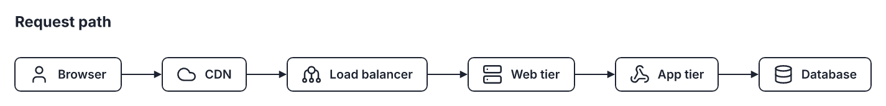</td></tr>
<tr><th align="left"><code>direction down</code></th></tr>
<tr><td>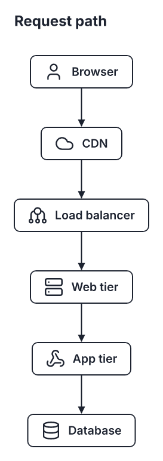</td></tr>
</table>

**Result:** the same six steps fit a page. A strip more than about four times wider than tall is folded into
rows by the engine anyway (rule 4), but for layered things choosing the direction yourself is the better move:
the tiers stay whole instead of being cut where the fold happens to fall.

## 2. Put siblings across the flow, not along it

**Rule:** nodes that are reached from the same place go side by side **across** the flow: in a **row** when
the diagram goes down, in a **column** when it goes right.

**Why:** nodes stacked *along* the flow stand in each other's way. The link to the one behind cannot go
straight, so it leaves its source sideways, runs round the first ones and comes back in. Across the flow
every node has a clear line from what feeds it and to what it feeds.

**Write:** change `column { … }` to `row { … }` (or the other way round).

<table>
<tr><th>A column, along a downward flow</th><th>A row, across it</th></tr>
<tr>
<td valign="top">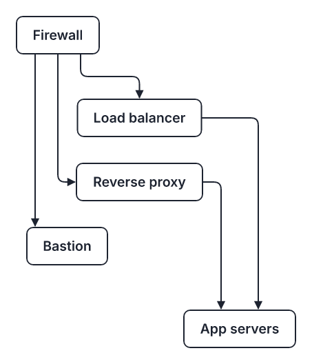</td>
<td valign="top">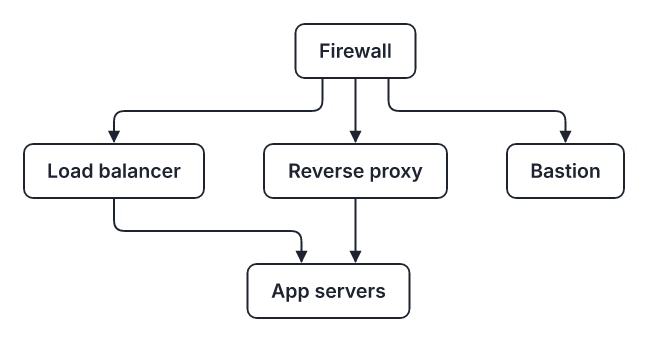</td>
</tr>
</table>

**Result:** every link leaves its node on the side facing its target, one bend at most. This is the rule most
likely to apply to your next diagram.

**Symptom:** a link that leaves a box by the side, runs a long way, and turns back in.

## 3. Let the flow place the zones; write rows and columns of zones only to decide

**Rule:** zones are placed in the order the flow crosses them, so a chain of zones needs no block around it.
Put zones in a `row` or `column` only when you want something the flow would not give you: two zones next to
each other, a grid, or a particular order.

**Why:** a block that repeats what the flow already does adds nothing but lines to maintain, and it fixes an
order the engine could otherwise choose to save crossings. A block that decides something is worth its lines:
here a chain of four zones becomes a two-by-two grid.

**Write:**

```
column {
  row { frame edge "edge" { … }  frame dmz "DMZ" { … } }
  row { frame app "app zone" { … }  frame data "data zone" { … } }
}
```

<table>
<tr><th align="left">The flow decides</th></tr>
<tr><td>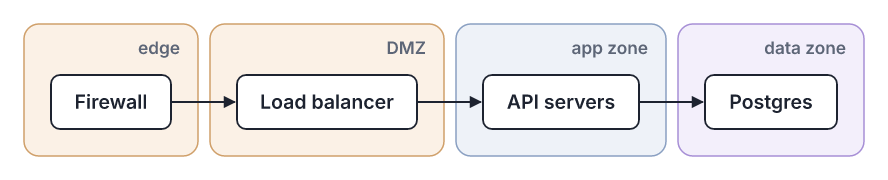</td></tr>
<tr><th align="left">Rows of zones</th></tr>
<tr><td>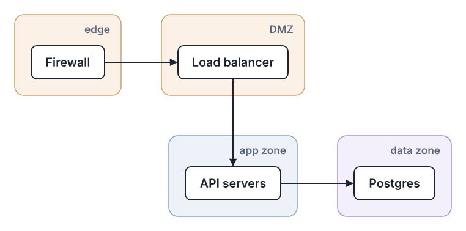</td></tr>
</table>

**Result:** you decide who is next to whom; links still decide the details inside each zone. The price is
paid by links between zones that end up in different rows: keep zones that talk most one after the other.

**Symptom:** long links between two zones that sit in different rows or columns. Put those two zones one after
the other along the flow instead.

## 4. Keep the drawing roughly the shape of a page

**Rule:** a long chain is folded into rows rather than drawn as a strip.

**Why:** a drawing many times wider than tall is shrunk to fit the screen, and its text becomes unreadable.

**Write:** nothing: the engine folds a chain much wider than tall. Write rows yourself (rule 3) to choose
where it folds, for instance one row per stage of a pipeline.

<table>
<tr><th align="left">Folding off</th></tr>
<tr><td>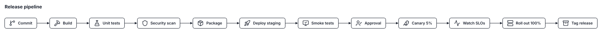</td></tr>
<tr><th align="left">Folding on (automatic)</th></tr>
<tr><td>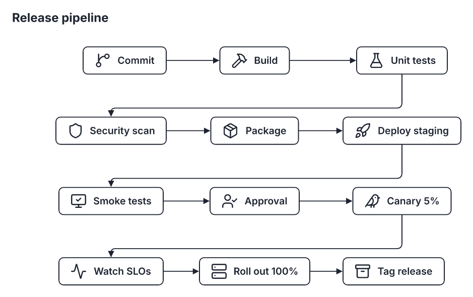</td></tr>
</table>

**Result:** each wrap costs one link that comes back to the start of the next row. With frames the same idea
is tried on the zones and refused when it adds crossings, or when that link would cross much of the page.

## 5. Put a gateway on the border it guards

**Rule:** a node that belongs to two zones (a firewall, a gateway, a transit router) sits on their shared
border, half in each.

**Why:** that is how network engineers draw it, and it says at a glance “this is the only way in”. Inside one
zone, the firewall looks like one more server, and the gap between the zones means nothing.

**Write:** `fw [bridge]: Internal firewall` (often with `span`, rule 6)

<table>
<tr><th>Without</th><th><code>[bridge span]</code></th></tr>
<tr>
<td valign="top">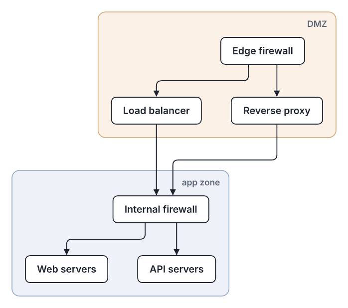</td>
<td valign="top">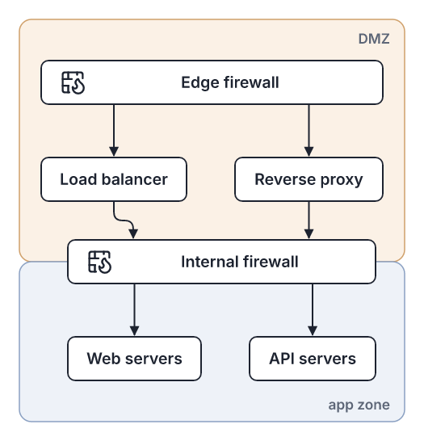</td>
</tr>
</table>

**Result:** the two zones are made to touch, the firewall straddles the line. It needs the zones one after the
other along the flow: zones placed beside each other by a block have no shared border, and the bridge is drawn
as an ordinary node.

## 6. Let a fan land straight

**Rule:** links between one node and several side by side arrive straight, one attachment point each.

**Why:** two sources further apart than the node they feed is wide have nowhere straight to land: their links
slide inward and bunch up at its edge, each with a bend.

**Write:** `ddos [span]: DDoS scrubbing`

<table>
<tr><th>Without</th><th><code>[span]</code></th></tr>
<tr>
<td valign="top">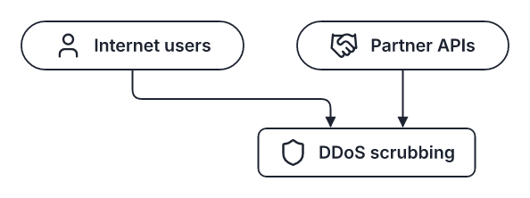</td>
<td valign="top">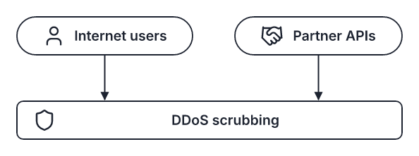</td>
</tr>
</table>

**Result:** the node grows as wide (or tall) as the stack it feeds, with one attachment point under each
member. A wider stack on its other side attaches in proportion, and those links may keep a step.

## 7. Give tiers straight sides

**Rule:** zones stacked as tiers share their edges.

**Why:** ragged sides read as a meaning that is not there (this zone is smaller, that one is off to the side).
Straight sides read as one stack of layers.

**Write:** `same-width edge app data` (or `same-height` for zones side by side)

<table>
<tr><th>Without</th><th><code>same-width a b c</code></th></tr>
<tr>
<td valign="top">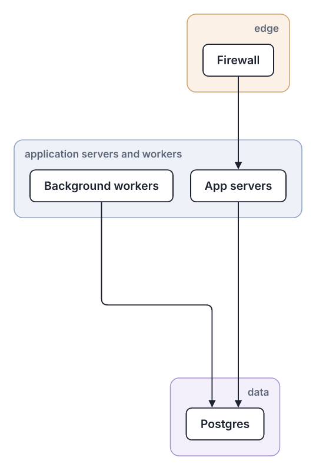</td>
<td valign="top">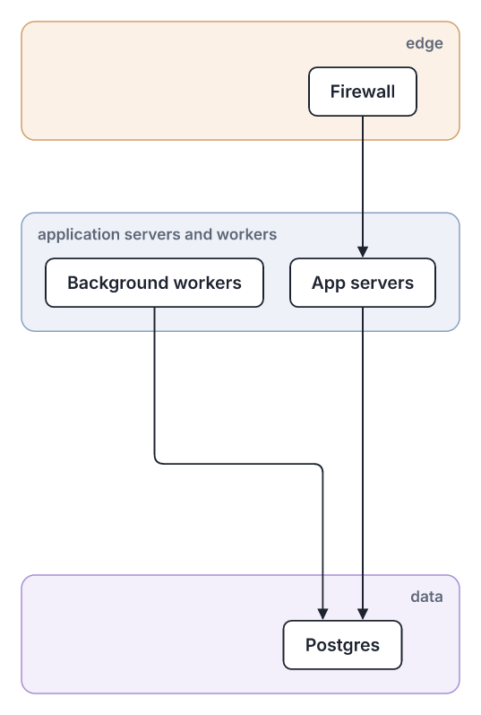</td>
</tr>
</table>

**Result:** it is a statement about relations, not a number, so it keeps working when a label changes.

## 8. Keep linked pairs level across blocks

**Rule:** two nodes linked across blocks (stacks, zones, rows) sit level, so the link between them is straight.

**Why:** each block is placed on its own. A node centred in a column of wider blocks lands under the middle of
the column, not under the node that leads to it, and the link takes a step.

**Write:** usually nothing: the engine slides stacks and zones into line on their links. When a step stays,
name the pair: `align slo rollback`.

<table>
<tr><th>Without</th><th><code>align slo rollback</code></th></tr>
<tr>
<td valign="top">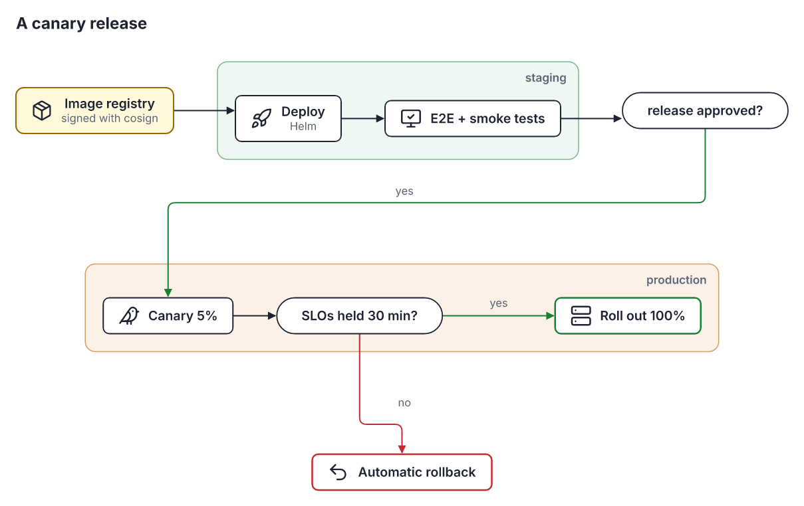</td>
<td valign="top">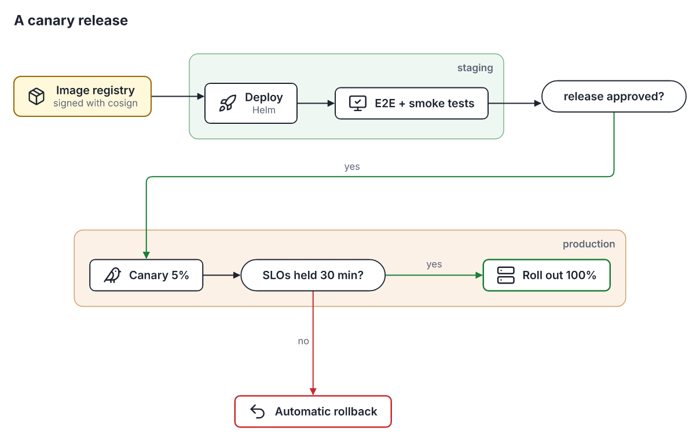</td>
</tr>
</table>

**Result:** the blocks (and their zones) slide into line on those nodes; a node in a zone moves with its whole
zone. It can cost a bend in other links between the two blocks, and it does not remove crossings: use it for the
neatness of a pair, not to untangle.

## 9. Put what watches the diagram beside it, not after it

**Rule:** logging, monitoring, administration and security tooling stand beside the main flow.

**Why:** a zone that only receives links looks, to the engine, like the end of the flow, so it becomes the
last tier, and every link to it runs the length of the drawing. Beside the flow, each link crosses one gutter.

**Write:** `frame obs "observability" [side] { … }`, with `span` to make it as tall as the zones it serves

<table>
<tr><th>Stacked after the last tier</th><th><code>[side]</code></th></tr>
<tr>
<td valign="top">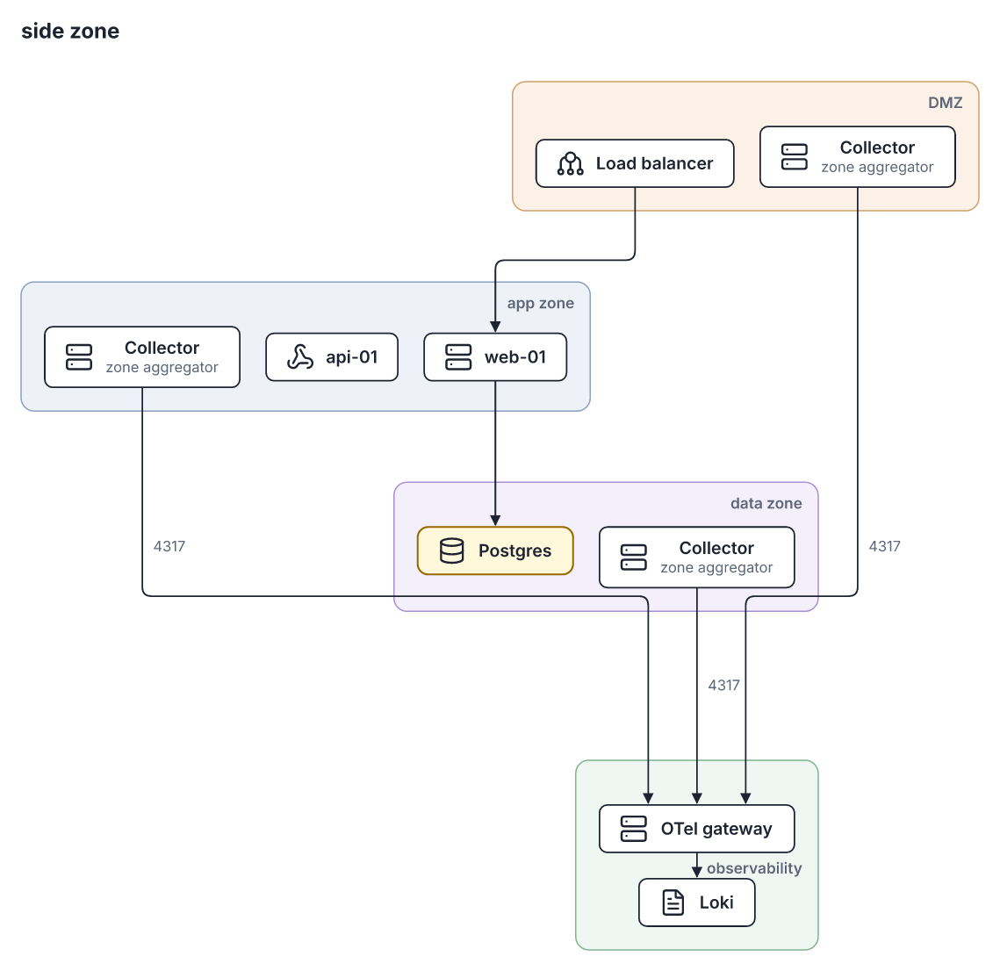</td>
<td valign="top">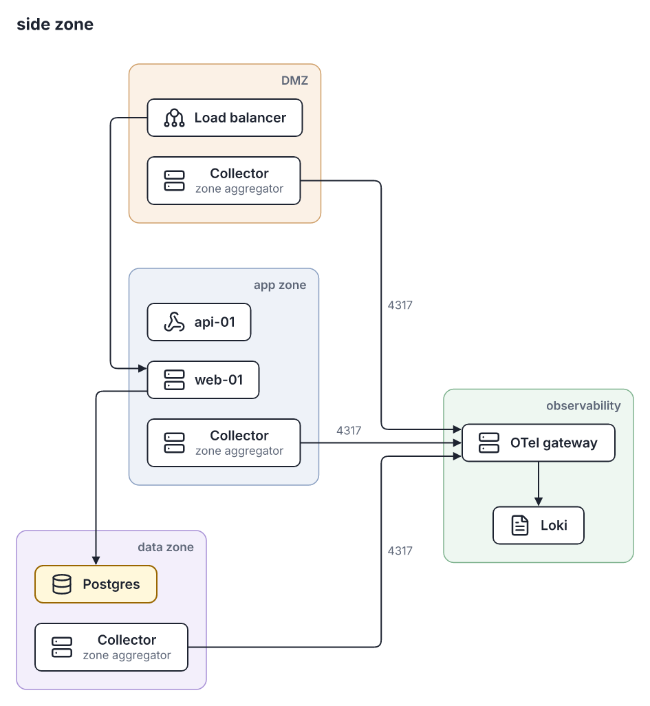</td>
</tr>
</table>

When those links touch many nodes and are no part of the story at all (logs to a SIEM, a scheduler's triggers),
take them out of the layout with a **rail**: each runs straight to a bus on the edge, and the drawing looks as
it did before they were added. Put the rail on the side the nodes are near.

<table>
<tr><th>Links in the layout</th><th><code>rail logs "management" [right] { siem: SIEM }</code></th></tr>
<tr>
<td valign="top">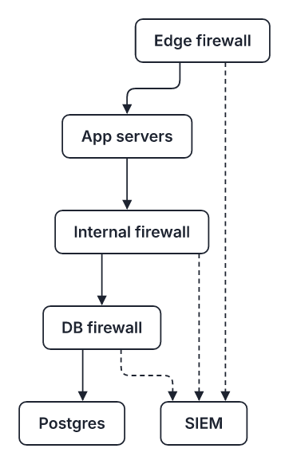</td>
<td valign="top">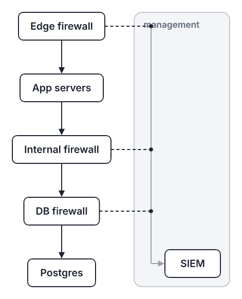</td>
</tr>
</table>

## 10. Write links in the order of the story; point the arrow with `<-`

**Rule:** the layout follows the order of the story, and the arrow points at what is acted on. When they
disagree, write the link in story order and turn the arrow round with `<-`.

**Why:** links set the flow. A worker that polls the database comes after it in the story, but the arrow
points into the database; written `worker -> pg`, it would pull the worker in front of the database and turn
that part of the drawing round. A link written against the flow loops round the whole diagram.

**Write:** `pg <- worker : claim a job`

<table>
<tr><th align="left"><code>pg -> worker</code></th></tr>
<tr><td></td></tr>
<tr><th align="left"><code>pg &lt;- worker</code></th></tr>
<tr><td></td></tr>
</table>

**Result:** the same layout with the arrow the right way. The same trick keeps a loop back (“dispute won”, “no,
PR blocked”) from turning a state machine or a pipeline round.

## 11. Many links into one node: one line, not a fan

**Rule:** links that carry the same thing to one node are drawn as one line that gathers them.

**Why:** ten links into one node read as a tangle, and say the same thing ten times. One line with one label
says it once.

Four answers, from the least written to the most:

**Same label, nothing to write.** Four or more links with the same label and style to or from one node become
one bus: a trunk at the node, a line past the sources, a branch from each, the label once. Links with different
labels stay apart.

<table>
<tr><th>Different labels</th><th>The same label (automatic)</th></tr>
<tr>
<td valign="top">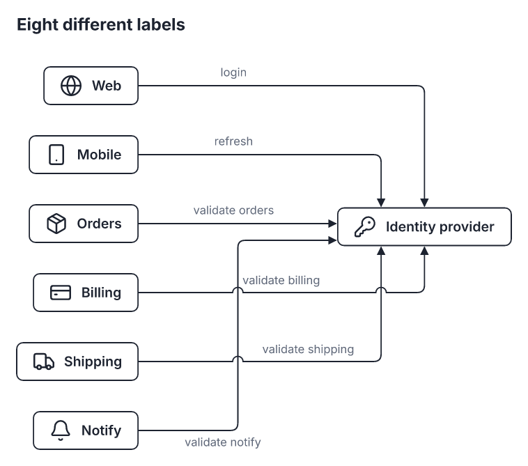</td>
<td valign="top">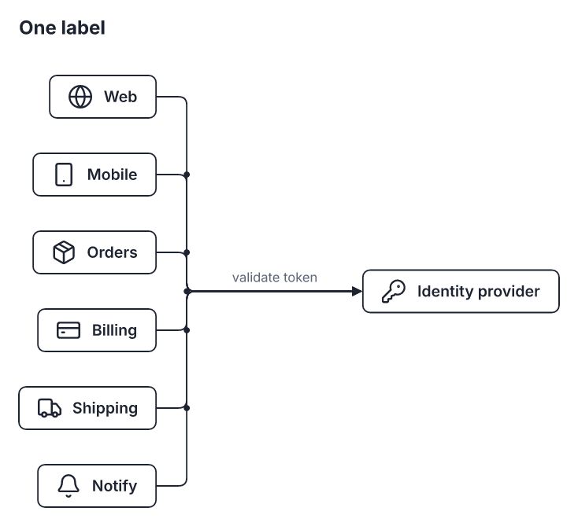</td>
</tr>
</table>

**Put the senders in a zone.** When five or more of them stand in one zone the node is not in, they meet a bar
inside the zone, and only one link crosses its edge.

<table>
<tr><th>Merging off</th><th>A bar inside the zone (automatic)</th></tr>
<tr>
<td valign="top">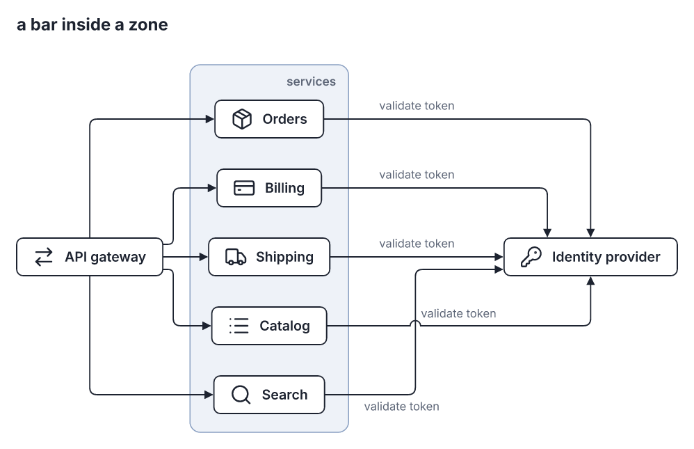</td>
<td valign="top">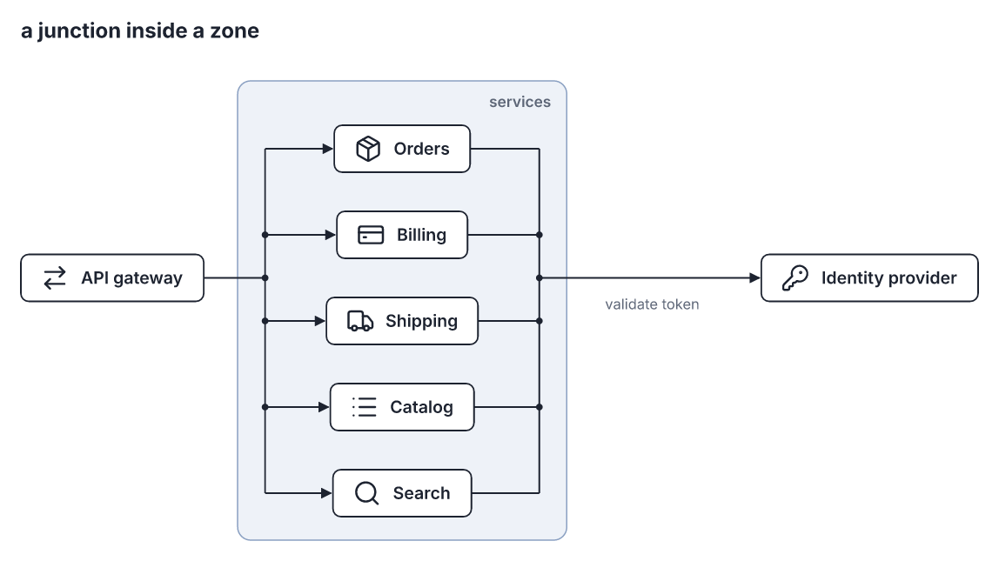</td>
</tr>
</table>

**Fewer than four, written.** Tag the node `[join]` (a gate after a parallel stage, a log collector): two or three
alike links meet a line with a dot, and one arrow reaches the node.

<table>
<tr><th>Three links</th><th><code>[join]</code> on the gate</th></tr>
<tr>
<td valign="top">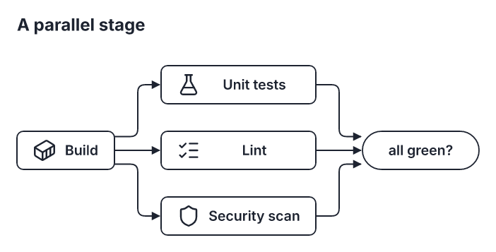</td>
<td valign="top">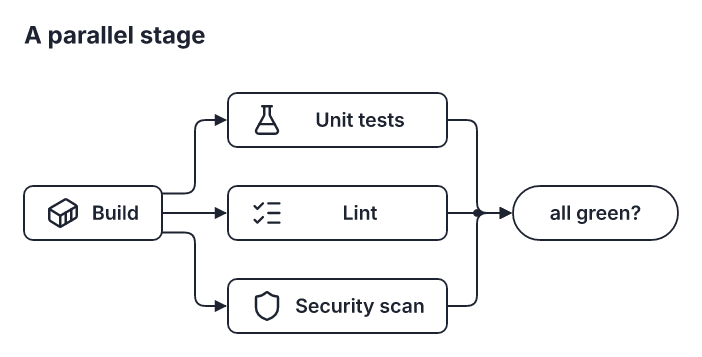</td>
</tr>
</table>

**Mark the node.** When the links say no more than “uses it” and the node is not what the diagram is about
(feature flags, a config service), `mark flagd "reads its feature flags from Flagd"` stops drawing them: each user
carries the node's icon, and a legend line explains it. Not for the subject of the diagram, nor for links that
carry their own labels.

<table>
<tr><th>Links drawn</th><th><code>mark</code></th></tr>
<tr>
<td valign="top">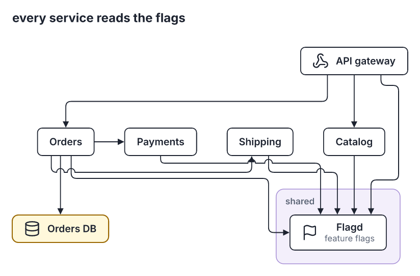</td>
<td valign="top">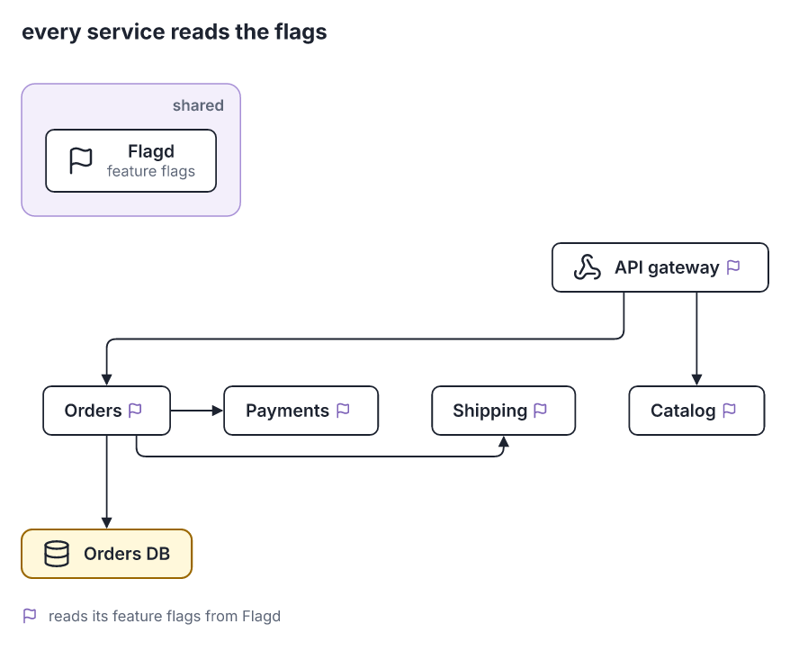</td>
</tr>
</table>

## 12. Say what things are

Not layout, and always worth doing:

- **Ports and protocols on the links**: `lb -> app : 443/tcp`. They cost nothing and make a network diagram worth
  reading.
- **Icons** for recognisable elements (`[database]`, `[firewall]`, `[user]`), left of the text; `top` for tall,
  narrow nodes. Not on decisions or states.
- **Technology logos** when the reader cares what a part is built with: `[database postgresql]` keeps the role icon
  and writes “PostgreSQL” with its logo under the name.
- **Zones named for what they are**, with the address range or owner in the title.

## Reading a result

| What you see | What it means | Try |
|---|---|---|
| A strip many times wider than tall, text tiny at page width | too many steps in one line | `direction down` (1), or rows of zones (3) |
| A link that leaves a box sideways and comes back | siblings stacked along the flow | swap `column` and `row` (2) |
| Long links between zones in different rows | a block splits zones that talk | put them one after the other along the flow (3) |
| A block around zones the flow already stacks | it repeats the flow | remove it and compare (3) |
| A firewall floating inside one zone | it belongs to two | `[bridge]`, with the zones one after the other (5) |
| Two links that slide inward and bunch up at a node | the sources are wider apart than the node | `[span]` on the node (6) |
| Tiers with ragged sides | each zone sized on its own | `same-width` (7) |
| A link between two blocks with a step the engine leaves | the blocks are centred apart | `align` on the pair (8) |
| A monitoring zone stacked as the last tier | it only receives links | `[side]`, or a `rail` (9) |
| A long link looping round the whole diagram | a link written against the flow | write it in story order with `<-` (10) |
| A fan of links into one node | the same thing said many times | one label, a zone round the senders, `[join]` or `mark` (11) |
| Nodes that all look the same | nothing says what they are | icons, logos, ports (12) |

Links keep clear of frame borders by themselves (a stretch within 8 px of a border moves to 12 px). Two cases stay:
a link that leaves its node already running along a border, and a link between two nodes on the same border.

## Checklist

1. Write the plain version and look at it.
2. Pick the direction: down for tiers, right for pipelines.
3. Put siblings across the flow.
4. Let the flow place the zones; add rows and columns of zones only to decide something.
5. Tag borders with `[bridge]`, fans with `[span]`; give tiers `same-width`.
6. Put what watches the diagram beside it.
7. Gather many links into one node.
8. Add ports, icons and logos.

## The rules together

The three-tier network behind a DMZ, first written plainly (nodes, links, zones, `direction down`), then with
the rules above: rows across the flow inside each zone (2), firewalls on the borders (5) as wide as what they
feed (6), the two sources centred over the first node (a `column` holding them and the edge zone, 3), the SIEM in
a `[side span]` zone with its three log links joined (9, 11), icons (12).

<table>
<tr><th>Plain</th><th>With the rules</th></tr>
<tr>
<td valign="top">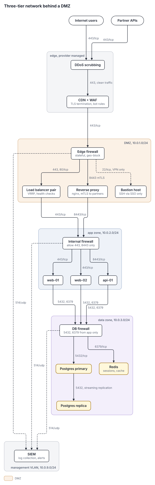</td>
<td valign="top">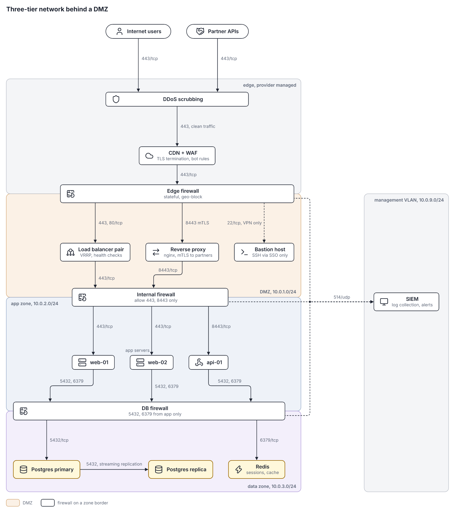</td>
</tr>
<tr>
<td valign="top"><a href="../examples/cases/simple/dmz.trace">source</a></td>
<td valign="top"><a href="../examples/cases/dmz.trace">source</a></td>
</tr>
</table>

The plain drawing is already correct: every link is clear, nothing overlaps. What the rules add is what a reader
sees first: where the borders are, what crosses them, and what only watches.
