# The Trace manual

Everything you can write in Trace, then how to make a diagram look right. New to Trace? Start with
[getting started](getting-started.md); coming from Mermaid, see [coming from Mermaid](coming-from-mermaid.md).

- [Part 1: the language](#part-1-the-language)
- [Part 2: making a diagram look right](#part-2-making-a-diagram-look-right)

## Part 1: the language

One statement per line. `#` starts a comment (outside quotes, at line start or after a space).

### Whole-diagram settings

```
direction down        # right (default, also lr) or down (also td, tb)
spacing 1.3           # multiplies layout spacing, 0.5 to 3
gather 4              # alike links into one node drawn as one bus: 5 by default, 2 up, or off
title "Job states"    # drawn above the diagram; also the SVG's aria-label and the download file name
caption "Production, eu-west-1. Dashed links are optional."   # a muted line under the title, wrapped
title-block {         # a small table at the bottom right: free key: value lines
  author: Yves
  date: 2026-11-25
  version: 1.2
}
```

All of these are optional. `gather` sets how many links with the same label and style, into or out of one
node, are drawn as one bus (or meet one line inside a zone when they come from its members): five by default,
`gather 3` for fewer, `gather off` for never. `[gather]` on a node, or on the links themselves, asks for it from two links whatever the setting.

The title and the caption sit above the drawing, which moves down to make room; a
long caption wraps to the drawing's width, and several `caption` lines make several paragraphs. The
title block is the small table in the corner of an engineering drawing (who made it, when, which version): any keys
you like, in the order you write them.

### Layout is automatic

Write nodes and links and nothing else: the engine places everything, folds a long chain into rows, and draws
zones around their members. When a drawing does not look right, [part 2](#part-2-making-a-diagram-look-right) says
what to add.

#### Hierarchies: `tree`

```
direction down
tree
```

The line `tree` draws a hierarchy as an org chart: each parent stands exactly over the middle of its children
(beside them in a diagram flowing right), and its links are one stem, one bar and a drop to each child. It
applies when the diagram is a hierarchy: one root, every node with one parent at most, no decision (`ask`), no
reversed or self link, four nodes or more. Zones around the nodes are fine; a parent never leaves its zone.
Otherwise a warning says so and the diagram is drawn as usual. Without the line a hierarchy is drawn like any
other diagram.

### Nodes

```
[kind] name [tags] : Bold label | muted note
```

- `name` is the id: letters, digits, `_ . -`, starting with a letter, digit or `_`.
- Without a label the name is shown. `\n` breaks a line; long text wraps on its own
  (names at about 210px, notes at 230px).
- Declaring a node again merges: a later line can add a kind, label or tags, and moves the node
  into the block it is declared in.
- A node first mentioned in a link is created where that link is written.

Kinds:

| kind | drawn as |
|---|---|
| `box` | default rounded rectangle |
| `store` | yellow, for databases, buckets, topics |
| `engine` | grey fill, for external engines and systems |
| `state` | more rounded, for state machines |
| `pill` | fully rounded, for people and external actors |
| `ask` | fully rounded, for decisions (write the `?` yourself) |
| `start` | filled dot |
| `final` (alias `end`) | double border, for terminal states |

Icons: any word in the brackets that is not a tag below names an icon, drawn left of the text:

```
pill users [user]: Internet users
fw [firewall]: Edge firewall | stateful, geo-block
lb [loadbalancer icon-top]: Load balancer pair | VRRP
```

- The names are the common diagram elements below, plus every Lucide icon under its own name
  (lucide.dev/icons), for example `brick-wall-fire` or `cable`. `lucide/bridge` names the Lucide icon
  `bridge`, since `bridge` alone is the tag.
- `icon-top` puts the icon above the text instead; the node gets taller instead of wider (`top` is its older name).
- Icons are drawn in the diagram's ink colour whatever the node's state.
- A name that does not exist is an error with a line number and close matches.
- The drawings of the common names ship with the engine. Any other Lucide icon is fetched from
  jsDelivr the first time a diagram uses it (Node reads it from `src/lucide.js`). If that fails, for
  example offline, the node is drawn without its icon and the result carries a warning.
- Common names: database, server, user, cloud, browser, queue, firewall, storage, loadbalancer,
  container, api, lock, mobile, internet, router, switch, wifi, vpn, dns, shield, laptop, monitor,
  printer, camera, cache, function, clock, document, bell, chart, settings, mail, key.
  `examples/playground/icons.trace` draws them all with the Lucide name each one comes from.

Technology logos are written the same way, by the technology's name:

```
store pg [database postgresql]: Orders DB
api [go]: Orders API
frame k8s "Kubernetes cluster" [blue kubernetes] { ... }
```

- With a role icon, the logo stands small, in the note's grey, before the technology's name, which starts the
  note: `Orders DB` above reads "PostgreSQL" under its name, and `cache [zap redis]: Cache | sessions, 1 h` reads
  "Redis · sessions, 1 h" (a note that already starts with the name is left as it is).
- To show only the logo, write no role icon: `api [go]: Orders API`.
- Without a role icon, the logo takes the icon's place, and the note stays as written.
- On a frame, the logo stands before its title.
- Logos are drawn in one colour (the ink, or the note's grey when small), never in brand colours.
- The names are Simple Icons' (simpleicons.org; CC0, the logos remain their owners' trademarks), with short
  names for common ones: `kafka`, `postgres`, `k8s`, `node`, `vue`, `mongo`, `elastic`, `gcp`, `otel`, `golang`,
  `ts`, `js`, `traefik`, `argocd`, `hashicorp-vault`, `httpd` (Apache), and `java`, which draws OpenJDK's logo
  and names it so (Java's own is not available). A name that is also a Lucide icon or a Trace tag keeps
  that meaning (`vault`, `box`, `orange`...); write `logo/vault` for the logo.
- About forty common logos ship with the engine; any other is fetched from jsDelivr the first time a diagram
  uses it (Node reads it from the `simple-icons` package). AWS, Azure, Java, Oracle and OpenAI are not
  available: their owners had them removed.

Tags (in brackets, before the colon or at the end of the label):

| tag | effect |
|---|---|
| `ok` / `bad` | green / red border |
| `dashed` | dashed border (planned, optional, retired) |
| `muted` | soft grey border |
| `span` | grows to the full height (direction right) or width (down) of the column or row it links to; one connection point per member, so each link runs straight |
| `gather` | links into (or out of) it that look the same meet a line with a dot first, then one arrow reaches it, label written once; done by itself from five such links (see `gather`), the tag asks for it from two. For a parallel stage closing on a gate, or log links into one collector. `join` is its older name |
| `bridge` | sits on the border between its frame and the frame of a node linking into it, with the two frames widened into bands; for firewalls, gateways, anything on two networks |

### Links

```
a -> b : label [tags]
a -> b -> c            # chains; a label applies to every link of the chain
```

| operator | meaning |
|---|---|
| `->` | arrow |
| `-->` | dashed arrow |
| `<-` | arrow into the left node, but the layout still places the right node after it |
| `<--` | dashed version of `<-` |
| `<->` | arrowheads at both ends |
| `--` | no arrowhead |
| `==>` | the main path: a thicker arrow (same as `-> [main]`) |
| `-x`, `--x` | refused: a cross at the target instead of an arrowhead, solid or dashed (same as `-> [refused]`) |

You can write a link either way round: when a link points back against the order you declared the
nodes in, the layout treats it as a feedback link and keeps the main flow straight. `<-` is for when
you want to say so yourself, and is the main layout tool: `pg <- worker` keeps the worker on the far side of Postgres while the
arrow points at Postgres; `fw <- proxy` sends traffic back up without the layout turning around.

Link tags: `ok`, `bad`, `muted` (colour), `dashed`, `main` (thicker: the path to follow first), `refused` (a cross
at the target: traffic that is dropped), and `gather` (the tagged links into one node meet one line, from two up).
`==>` and `-x` count only with spaces around them, so a name such as `app-xray` stays a name.

Where the label goes: the engine puts it beside the link where it crosses nothing. A tag can ask for a place:
`[label-start]` (just past the source, on the first stretch), `[label-end]` (just before the target, on the last),
and `[label-above]`, `[label-below]` (on a horizontal stretch) or `[label-left]`, `[label-right]` (on a vertical
one); `[label-end below]` combines them. A hint is a preference: when its place is taken, the label goes where
there is room and the result carries a warning.

```
fw -> app : 443/tcp [label-end]              # the port next to the firewall's target
ask -> fix : no [label-start]                # yes and no next to the question
core -> sw : ge-0/0/1 | 10 Gb uplink | port 24   # a label at each end, around the middle one
core -> sw : ge-0/0/1 | | port 24            # the ends only
```

A label in three parts, `start | middle | end`, names the two ends of the link as well (interface names, roles);
each end label sits beside the link just past its end, on the side that is free. A part may be empty. A label
that needs a `|` of its own goes in quotes.

A link can also say how many at each end, source end first: `[n-1]` many to one, `[1-1]`, `[n-n]`, and
`01` and `0n` for zero or one and zero or many (`[0n-1]`). The ends are then drawn as in an ER diagram
(a crow's foot for many, two bars for one, a circle for optional) instead of arrowheads.

### Blocks

```
frame id "Title" [colour] {
  ...
}
column "optional title" {
  ...
}
row "optional title" {
  ...
}
```

- `frame` draws a titled zone. The title can also be written like a node's label: `frame dmz: DMZ, 10.0.1.0/24 [orange] {`. Colours: `green` (default), `blue`, `orange`, `purple`, `grey`;
  `dashed` also works. Frames nest. The id is optional; links can name a frame id. Without a title the id is
  shown as one; `frame paas "" [blue]` draws the zone with no title. A title too long for the room the zone has
  is shortened with an ellipsis (the whole title shows as its tooltip).
- `column` stacks nodes top to bottom, `row` side by side. They hold nodes only. Links between
  members run straight inside the stack. Stacks across the flow (columns when the direction is
  right) give every member the same width. Sibling stacks of the same length share slot sizes,
  so they line up row for row like a table.
- A title in quotes on a column or row is drawn as a small header above it.
- A row or column that holds **frames** (or other rows and columns) is a layout block: it places them
  side by side (row) or one above the other (column), in the order you write them, and draws nothing
  itself. Nest them for a grid. Links still decide the details inside each block; the block decides
  who is next to whom. It takes no title (put the title on a frame). Links may end on a zone
  (`cicd -> cluster`): the link stops on the zone's border, facing where it comes from.

```
column {
  row {
    frame edge "edge" { ... }
    frame dmz "DMZ" { ... }
  }
  row {
    frame app "app zone" { ... }
    frame data "data zone" { ... }
  }
}
```

  Inside a layout block the flow runs along the block (a row left to right, a column downwards), whatever
  the diagram's `direction`. A `[bridge]` only works between frames that share a border along the diagram's
  direction, so a firewall between two rows is an ordinary node. Layout blocks need the per-frame layout;
  if the diagram cannot be placed that way, the blocks are ignored and the result carries a warning.

### Tables (data models)

```
table orders "Orders" {
  id uuid pk
  customer_id uuid fk
  total numeric(10,2)
  note text null
}
orders.customer_id -> customers.id : placed by
audit_log --> orders.id : refers to, no foreign key
```

A `table` is a node with a header and one row per column: `name type` then any of `pk`, `fk`, `unique`
and `null` (a nullable column shows `?` after its type). The title in quotes is the header text (the name
by default); a tag or icon word in brackets works as on any node (`table orders [database] {`). A table
goes in a frame or at the top level.

A link can name a column, `orders.customer_id`, and then it leaves or enters level with that row, on the
side the diagram flows from and to. Links that meet the same row are spread within it. A link to the table
alone (`orders -> customers`) attaches wherever the layout puts it. `-->` and `[dashed]` give the dashed
link, for a reference without a foreign key. Tables are ordinary nodes otherwise:
frames, icons, `same-width`, `align`, rails and the rest apply; only a table inside a row or column of
nodes loses the row-level attachment.

### Sequence diagrams

```
sequence
title "How a job runs"
pill client [user]: Client
api [api]: API
store db [database]: Postgres

client -> api : POST /jobs
api -> db : insert job
api --> client : 202 accepted
note over api, db : one transaction
loop "every 5 s" {
  worker -> api : claim a job
}
alt "success" {
  worker -> api : report done
else "failure"
  worker -> api : report error
}
```

A line `sequence` switches the diagram to time running down. Participants are nodes, so kinds, icons
and tags work; they run across the top in the order they are first mentioned (declare them first to
choose the order). Each link is a message, in the order written: `->` solid, `-->` dashed (a reply),
`<-` and `<--` put the arrowhead at the left end, and a message to yourself draws a small loop. A
label gets as much room between its lifelines as it needs.

- `note over a, b : text`, `note over a : text`, `note left of a : text`, `note right of a : text`.
- `loop "label" { ... }`, `alt "label" { ... }`, `opt "label" { ... }` and `par "label" { ... }` draw a
  group round the messages inside; they nest. Inside an `alt`, a line `else "label"` starts the next
  branch with a dashed divider (`and "label"` inside a `par`).
- No frames, rows, columns, rails, `align` or `same-width` in a sequence diagram.

### Side zones

```
frame obs "observability" [green side] {
  gw: OTel gateway
}
frame admin "admin access" [orange side left span] {
  bastion: Bastion host
}
```

A frame tagged `side` stands **beside** the main flow instead of after it. Use it for what watches or
administers the diagram rather than being part of its path: logs, metrics, admin access.

- Only the two sides across the flow exist: left and right in a diagram that flows down (the default side is
  right), top and bottom in one that flows right (the default is bottom). The ends of the flow are where it
  starts and stops. Write `[side left]`, `[side top]` and so on to choose.
- A side zone goes at the top level. The rest of the diagram goes in a block of its own and the side zones in
  blocks beside it, so it is what you would write with rows and columns, written for you.
- Several zones on one side stack along it, in the order of where their links come from. One on each side is
  fine. More than two on a side is a sign to split the diagram.
- Each side zone sits level with the zones it is linked to.
- **`[side span]`** makes a side zone as tall as the zones it is linked to (as wide, beside a flow to the right),
  from the top of the first to the bottom of the last. The nodes inside move level with what they are linked
  to, so the links across the gutter are straight. A zone without `span` keeps its own height and the spanning
  zones on that side make room for it; two spanning zones share the length between them.
- Links go between nodes (`col1 -> gw`), not to the zone itself: a link to a zone is refused with a message
  while there are side zones.
- Mistakes name the line and what to write: a side zone inside another frame, `top` in a diagram that flows
  down, two sides on one zone, `span` without a side.

### Equal sizes

```
same-width edge core access      # frames
same-height lb rp bastion        # nodes
```

Makes the listed nodes, or the listed frames (not a mix), as wide (`same-width`) or as tall
(`same-height`) as the widest. Nodes are sized before anything is laid out, so the stacks and links
you build from them see the equal sizes (a `[span]` node can still grow afterwards). A frame takes its
size from what is inside it, so the smaller frames are grown afterwards: to one common box, with the
same edges, when the frames fit in it; otherwise around their own centre or to the free side. A frame
that cannot grow without covering another frame or node keeps its size, and the result says so.

### Rails

```
rail logs "management VLAN" [right] {
  siem: SIEM | log collection
}
fw1 -> logs : 514/udp
fw2 -> siem : 514/udp
```

A rail is a band along one edge of the whole diagram for links that touch many nodes: logging, monitoring,
scheduling. The nodes inside it are where the links end; a link to the rail's name or to a node in it
is a rail link. Each runs from its node straight to a bus line on the rail, and the bus feeds the nodes
with an arrow. Rail links take no part in the layout, so adding a rail never moves anything else.

- `[top]`, `[bottom]`, `[left]` or `[right]` picks the edge (default: bottom for a diagram that flows
  right, right for one that flows down). A colour (`[grey]`, `[blue]` ...) and `[dashed]` work as on frames.
- A rail goes at the top level and holds nodes only.
- A link crosses whatever lies between its node and the rail, so a rail suits nodes near the edge it runs
  along. When a link would cross another node, the result carries a warning saying which.

### Aligning two nodes

```
align tPay payment
```

Puts two linked nodes in different rows or columns level: the stacks are brought into line on them and
the link between them is drawn as one straight line. They need a link between them (`tPay -> payment`),
and each pair of stacks can have one such pair. `align a b c` keeps `a` with `b` and `b` with `c`. If it
cannot be done without touching another node, the diagram is left as laid out and says so.

It also works on single nodes and on nodes inside zones: `align registry deploy e2e approve` slides the
registry, the staging zone (with Deploy and E2E in it) and the approval until all four nodes are level, and
draws the links between them straight. A node inside a zone moves with its whole zone, so its contents stay
inside it; a zone is only moved when the other node is not inside it.

### Legend

```
key box [dashed] : planned
key -> [bad] : failure path
key final : terminal state
key frame [orange] : DMZ
```

Shape is any node kind, `frame`, or an arrow (`->`, `-->`, `--`). Keys are laid out in a row under
the diagram.

### Notes

```
note db : read replica planned for Q3          # a node or a zone
note api -> db : pool of 20 connections        # a link
note : numbers from the March load test        # the whole diagram
notes numbered                                 # or margin; auto by default
```

A note is a comment about the drawing, not a part of it, and takes no part in the layout. Short notes go beside
their subject, in the first free room to its right, in italic, each with a hairline to a small pin on it (a node's
right side, a zone's corner, the middle of a link); a hairline passes behind the boxes, or under the drawing when a
box is in its way. When the notes are many or long, they become numbered dots on their subjects, with the text listed under the
drawing. `notes margin` or `notes numbered` chooses for the whole diagram. A note can name only what is in the
diagram; the error says what to write.

### Marks

```
mark flagd "reads its feature flags from Flagd"
mark config [settings] "reads its settings"
```

A node that most of the diagram uses (feature flags, a config service, an identity provider) draws a fan of
links across every tier. `mark <node> "text"` stops drawing the links that arrive at that node: each node they
come from carries a small icon after its name instead, and the legend under the diagram shows the icon with the
text. The links stay in the source and stay out of the layout; delete the `mark` line and they are drawn again.

- The icon is the marked node's own icon; write one in brackets when it has none, or to use another.
- The icon takes the colour of the zone the marked node stands in (muted grey outside any zone).
- Only links whose arrow ends at the marked node become marks; links leaving it are drawn as usual.
- One `mark` line per node. A frame cannot be marked, and a mark needs at least one link arriving.
- A marked node with no link left to draw stands at the end of the flow (a shared library after what uses it).

### Errors

Every problem is reported with its line number and what to write instead; the playground lists
them under the editor and keeps showing the last good drawing, faded.

## Part 2: making a diagram look right

Most diagrams need nothing more than part 1. When one does not look right, these are the rules a good diagram
follows, each with the hint that gets it. Write the plain version first and look at it: a hint only says what the
engine cannot guess, and every hint is one more thing to maintain. Each picture pair is the same text without and
with the hint; the source shown is the one with it.

### 1. Choose the direction from the shape of the story

Layers that something crosses in order go **down**; a sequence of steps goes **right** (the default). Write
`direction down`.

<table>
<tr><th align="left">To the right (default)</th><th align="left"><code>direction down</code></th></tr>
<tr><td valign="top">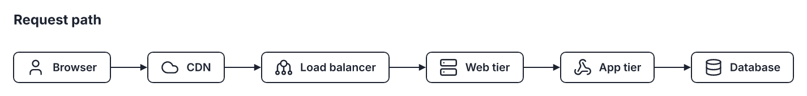</td>
<td valign="top">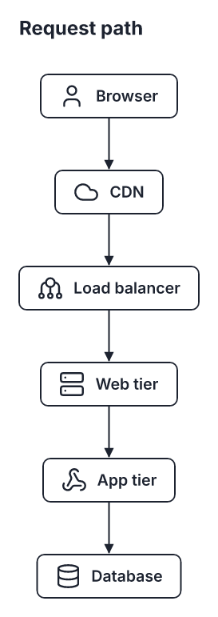</td></tr>
</table>

<!-- source examples/features/direction.after.trace "Trace source" -->
<details><summary>Trace source</summary>

```
direction down
title "Request path"
user [user]: Browser
cdn [cloud]: CDN
lb [loadbalancer]: Load balancer
web [server]: Web tier
app [api]: App tier
db [database]: Database
user -> cdn -> lb -> web -> app -> db
```

</details>
<!-- /source -->

### 2. Put siblings across the flow, not along it

Nodes reached from the same place go side by side across the flow: a `row` when the diagram goes down, a `column`
when it goes right. Stacked along the flow, each one stands in the way of the next.

<table>
<tr><th>A column, along the flow</th><th>A row, across it</th></tr>
<tr><td valign="top">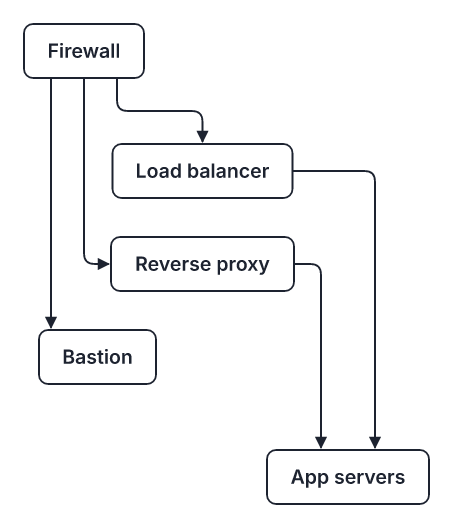</td>
<td valign="top">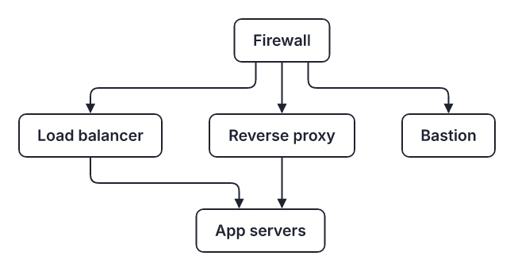</td></tr>
</table>

<!-- source examples/features/across.after.trace "Trace source" -->
<details><summary>Trace source</summary>

```
direction down
fw: Firewall
row {
  lb: Load balancer
  rp: Reverse proxy
  bastion: Bastion
}
app: App servers
fw -> lb
fw -> rp
fw -> bastion
lb -> app
rp -> app
```

</details>
<!-- /source -->

### 3. Let the flow place the zones; use rows and columns of zones only to decide

Zones are placed in the order the flow crosses them. Put them in a `row` or `column` only for something the flow
would not do: two zones side by side, a grid, a particular order.

<table>
<tr><th>The flow decides</th><th>Rows of zones</th></tr>
<tr><td valign="top">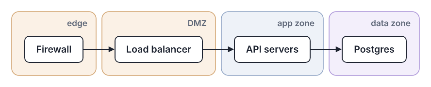</td>
<td valign="top">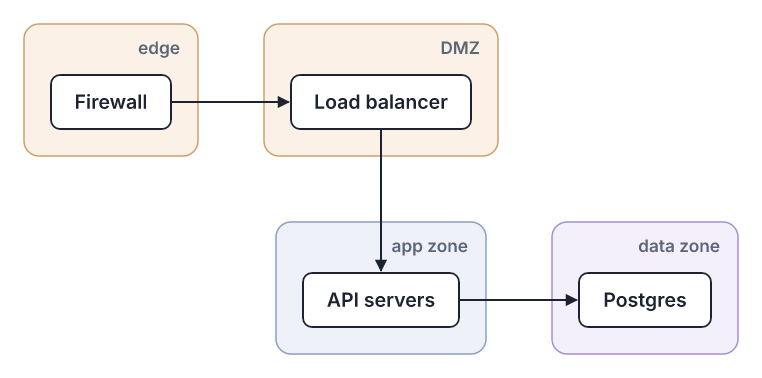</td></tr>
</table>

<!-- source examples/features/lanes.after.trace "Trace source" -->
<details><summary>Trace source</summary>

```
column {
  row {
    frame edge "edge" [orange] {
      fw: Firewall
    }
    frame dmz "DMZ" [orange] {
      lb: Load balancer
    }
  }
  row {
    frame app "app zone" [blue] {
      api: API servers
    }
    frame data "data zone" [purple] {
      db: Postgres
    }
  }
}
fw -> lb -> api -> db
```

</details>
<!-- /source -->

### 4. Put a gateway on the border it guards

A firewall or gateway between two zones sits on their border, half in each: `[bridge]`. With `span` it is as wide
as what it feeds, so every link drops straight.

<table>
<tr><th>Without</th><th><code>[bridge span]</code></th></tr>
<tr><td valign="top">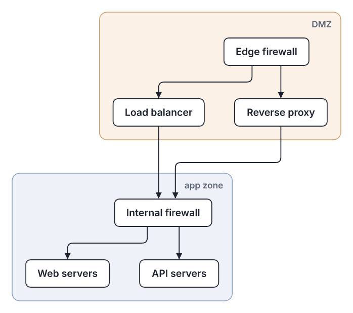</td>
<td valign="top">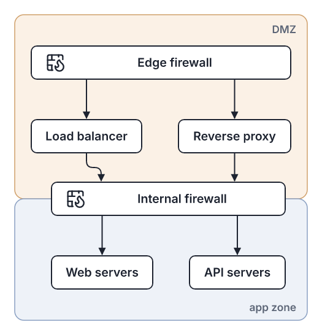</td></tr>
</table>

<!-- source examples/features/bridge.after.trace "Trace source" -->
<details><summary>Trace source</summary>

```
direction down
frame dmz "DMZ" [orange] {
  fw1 [bridge span firewall]: Edge firewall
  row {
    lb: Load balancer
    rp: Reverse proxy
  }
}
frame app "app zone" [blue] {
  fw2 [bridge span firewall]: Internal firewall
  row {
    web: Web servers
    api: API servers
  }
}
fw1 -> lb
fw1 -> rp
lb -> fw2
rp -> fw2
fw2 -> web
fw2 -> api
```

</details>
<!-- /source -->

### 5. Let a fan land straight

Sources wider apart than the node they feed bunch up at its edge. `[span]` makes the node as wide as they are.

<table>
<tr><th>Without</th><th><code>[span]</code></th></tr>
<tr><td valign="top">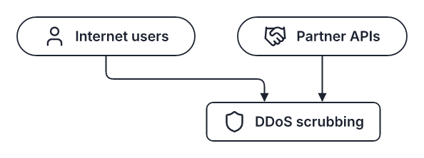</td>
<td valign="top">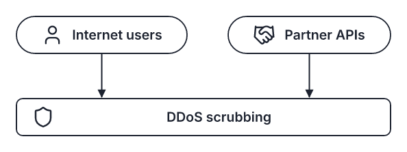</td></tr>
</table>

<!-- source examples/features/span.after.trace "Trace source" -->
<details><summary>Trace source</summary>

```
direction down
row {
  pill users [user]: Internet users
  pill partners [handshake]: Partner APIs
}
ddos [span shield]: DDoS scrubbing
users -> ddos
partners -> ddos
```

</details>
<!-- /source -->

### 6. Give tiers straight sides, and keep linked pairs level

`same-width a b c` gives stacked zones one width; `align a b` puts two linked nodes in different blocks on one line
when the engine leaves a step.

<table>
<tr><th><code>same-width</code></th><th><code>align slo rollback</code></th></tr>
<tr><td valign="top">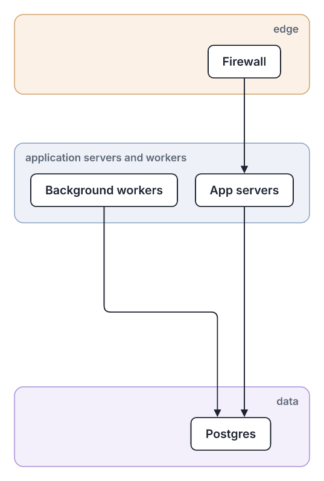</td>
<td valign="top">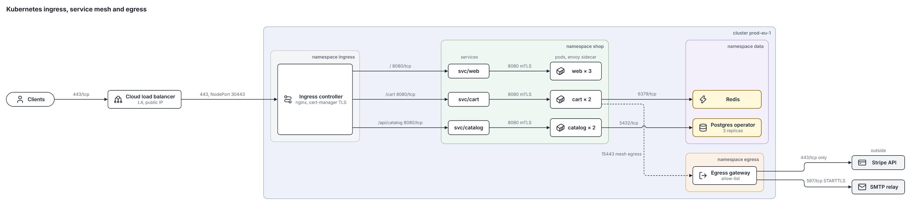</td></tr>
</table>

<!-- source examples/features/samewidth.after.trace "Trace source, same-width" -->
<details><summary>Trace source, same-width</summary>

```
direction down
frame a "edge" [orange] {
  fw: Firewall
}
frame b "application servers and workers" [blue] {
  app: App servers
  jobs: Background workers
}
frame c "data" [purple] {
  db: Postgres
}
fw -> app
app -> db
jobs -> db
same-width a b c
```

</details>
<!-- /source -->
<!-- source examples/features/align.after.trace "Trace source, align" -->
<details><summary>Trace source, align</summary>

```
title "A canary release"
column {
  row {
    store registry [package]: Image registry | signed with cosign
    frame staging "staging" [green] {
      deploy [rocket]: Deploy | Helm
      e2e [monitor-check]: E2E + smoke tests
    }
    ask approve: release approved?
  }
  column {
    frame prod "production" [orange] {
      canary [bird]: Canary 5%
      ask slo: SLOs held 30 min?
      full [ok server]: Roll out 100%
    }
    rollback [bad undo-2]: Automatic rollback
  }
}
registry -> deploy -> e2e -> approve
approve -> canary [ok] : yes
canary -> slo
slo -> full [ok] : yes
slo -> rollback [bad] : no

align slo rollback
```

</details>
<!-- /source -->

### 7. Put what watches the diagram beside it

Logs, monitoring and admin access are not the last tier: tag their zone `[side]` (with `span`, as tall as what it
serves). Links that touch many nodes and are no part of the story can go to a `rail` instead.

<table>
<tr><th>Stacked after the last tier</th><th><code>[side]</code></th></tr>
<tr><td valign="top">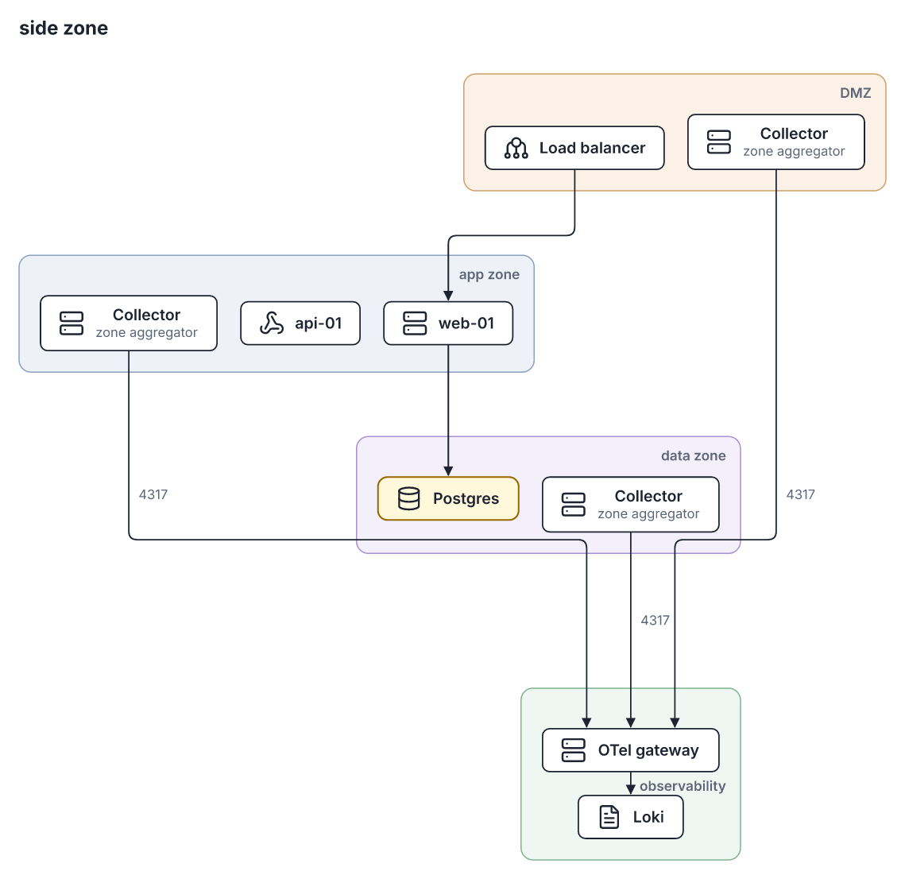</td>
<td valign="top">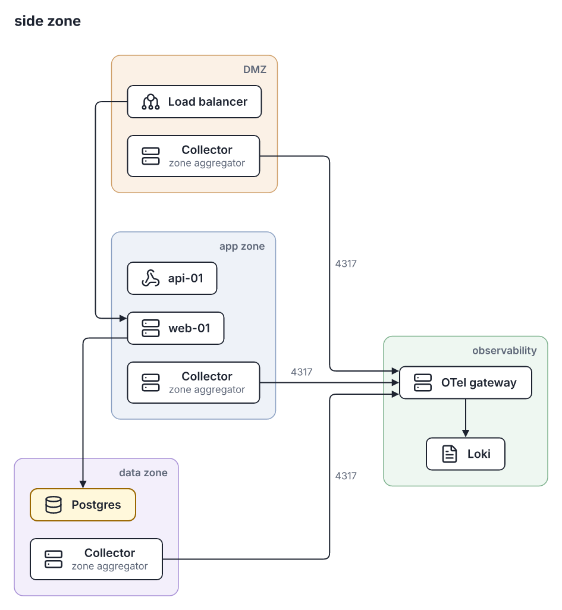</td></tr>
</table>

<!-- source examples/features/side.after.trace "Trace source" -->
<details><summary>Trace source</summary>

```
direction down
title "side zone"
frame dmz "DMZ" [orange] {
  lb [loadbalancer]: Load balancer
  col1 [server]: Collector | zone aggregator
}
frame app "app zone" [blue] {
  web1 [server]: web-01
  api1 [api]: api-01
  col2 [server]: Collector | zone aggregator
}
frame data "data zone" [purple] {
  store pg [database]: Postgres
  col3 [server]: Collector | zone aggregator
}
frame obs "observability" [green side] {
  gw [server]: OTel gateway
  loki [file-text]: Loki
}
lb -> web1
web1 -> pg
col1 -> gw : 4317
col2 -> gw : 4317
col3 -> gw : 4317
gw -> loki
```

</details>
<!-- /source -->

### 8. Write links in the order of the story

The layout follows the order links are written in; the arrow follows the operator. When the arrow should point
back (a worker that polls the database), write the link in story order with `<-`: `pg <- worker`.

### 9. Many links into one node: one line, not a fan

Five or more alike links into one node are gathered on one line by themselves (`gather N` changes the number).
For two to four, tag the node `[gather]`, or only the links that belong together (`a -> idp : token [gather]`). For links that say no more than "uses it", `mark` the node.

<table>
<tr><th>Five alike links, gathered</th><th><code>[gather]</code> on three</th></tr>
<tr><td valign="top">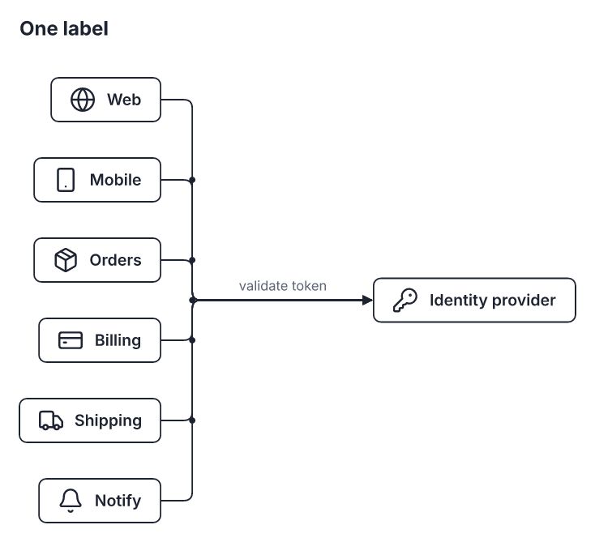</td>
<td valign="top">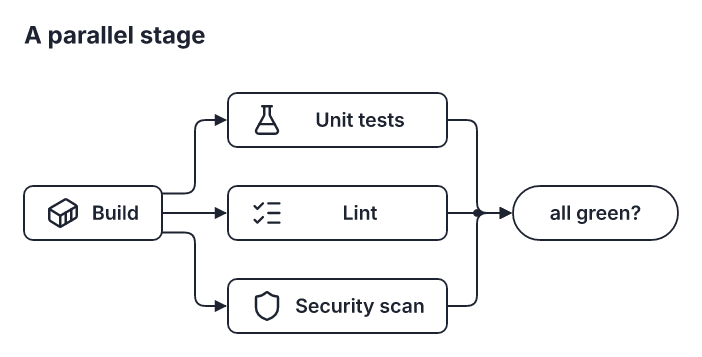</td></tr>
</table>

<!-- source examples/features/bus.after.trace "Trace source, gathered" -->
<details><summary>Trace source, gathered</summary>

```
title "One label"
idp [key]: Identity provider
a [globe]: Web
b [smartphone]: Mobile
c [package]: Orders
d [credit-card]: Billing
e [truck]: Shipping
f [bell]: Notify
a -> idp : validate token
b -> idp : validate token
c -> idp : validate token
d -> idp : validate token
e -> idp : validate token
f -> idp : validate token
```

</details>
<!-- /source -->
<!-- source examples/features/join.after.trace "Trace source, join" -->
<details><summary>Trace source, join</summary>

```
title "A parallel stage"
build [container]: Build
column {
  unit [flask-conical]: Unit tests
  lint [list-checks]: Lint
  sast [shield]: Security scan
}
ask gate [gather]: all green?
build -> unit
build -> lint
build -> sast
unit -> gate
lint -> gate
sast -> gate
```

</details>
<!-- /source -->

### 10. Say what things are

Ports on links (`lb -> app : 443/tcp`), icons (`[database]`, `[firewall]`), logos (`[database postgresql]`), and
zones named with their address range or owner. They cost nothing and make a diagram worth reading.

### Reading a result

| What you see | Try |
|---|---|
| A strip much wider than tall | `direction down` (1), or rows of zones (3) |
| A link that leaves a box sideways and comes back | swap `column` and `row` (2) |
| Long links between zones in different rows | put those zones one after the other along the flow (3) |
| A firewall floating inside one zone | `[bridge]` (4) |
| Links that bunch up at a node's edge | `[span]` on the node (5) |
| Ragged tiers, or a step between two blocks | `same-width`, `align` (6) |
| A monitoring zone stacked as the last tier | `[side]` or a `rail` (7) |
| A long link looping round the diagram | write it in story order with `<-` (8) |
| A fan of links into one node | `[gather]`, `gather N`, `mark` (9) |

Every feature, with its before and after, is also on the features page (`npm run build`, then `dist/features.html`).
